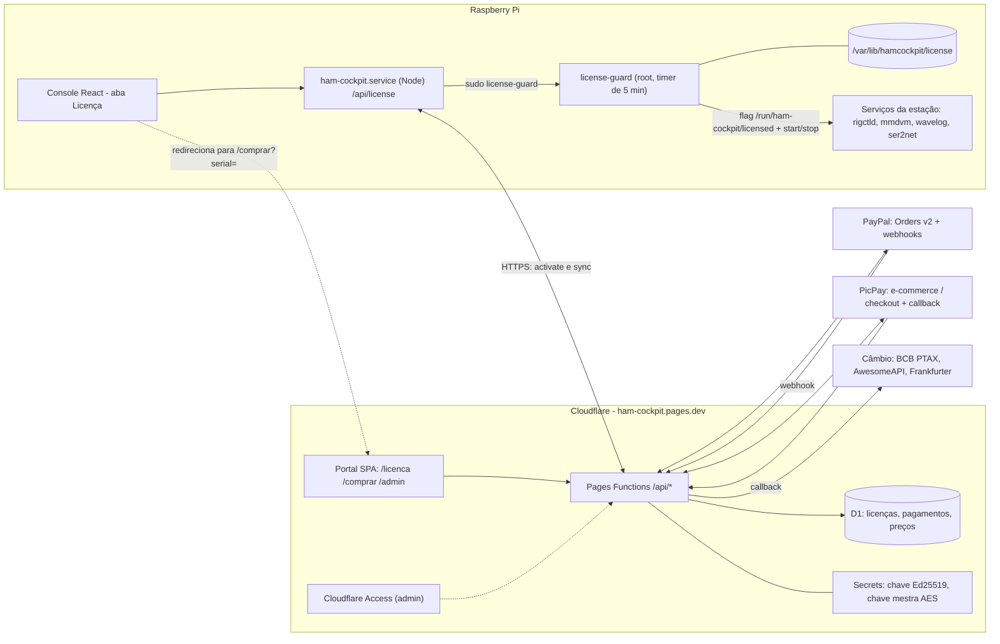
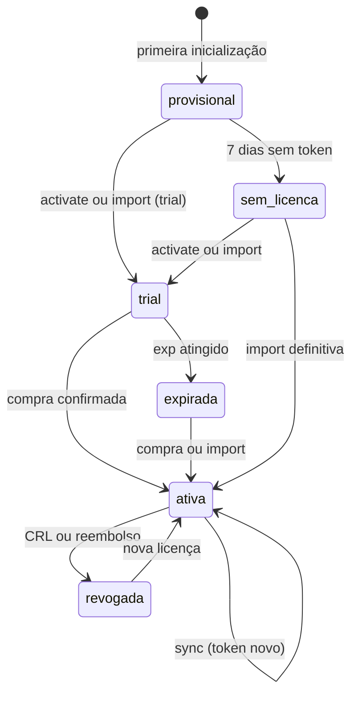
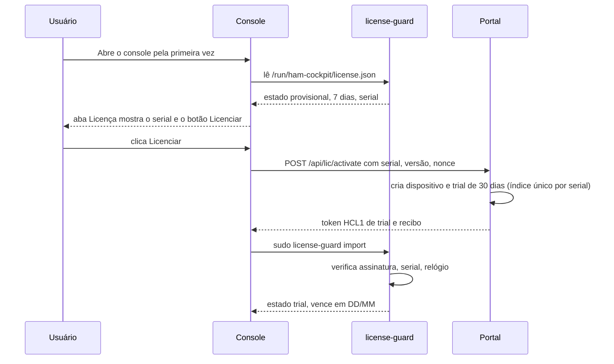
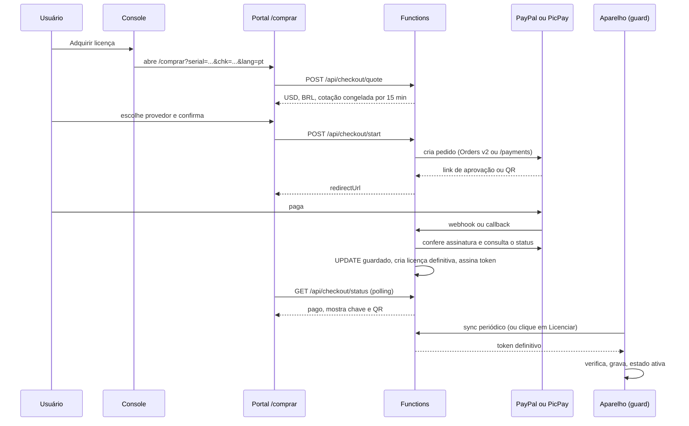

# Licenciamento do Ham Cockpit (estudo e plano)

| Item | Valor |
| --- | --- |
| Status | **Fases 1–3 em implementação** (modo observação no aparelho; bloqueio OFF) |
| Data | 2026-11-12 |
| Escopo | Chave de licença por serial do Raspberry Pi, trial de 30 dias, compra pelo portal (PayPal e PicPay), módulo admin; enforce fica para fase posterior |
| Código | `shared/license*`, `functions/`, `migrations/`, `server/license*`, portal `/licenca` `/comprar` `/admin`, aba Licença no console |
| Este documento | Plano + decisões do proprietário (abaixo). |

Lê-se em ordem: o [resumo executivo](#1-resumo-executivo-e-decisões-recomendadas) basta para decidir;
o resto é a especificação para implementar.

## Sumário

1. [Resumo executivo e decisões recomendadas](#1-resumo-executivo-e-decisões-recomendadas)
2. [O que o repositório já tem (e restringe)](#2-o-que-o-repositório-já-tem-e-restringe)
3. [Modelo de ameaças e limites honestos](#3-modelo-de-ameaças-e-limites-honestos)
4. [Arquitetura](#4-arquitetura)
5. [Identidade do aparelho: o serial](#5-identidade-do-aparelho-o-serial)
6. [Formato da licença assinada](#6-formato-da-licença-assinada)
7. [Trial, relógio e anti-adulteração](#7-trial-relógio-e-anti-adulteração)
8. [Fluxos passo a passo](#8-fluxos-passo-a-passo)
9. [Modelo de dados (D1)](#9-modelo-de-dados-d1)
10. [API do portal](#10-api-do-portal)
11. [API do aparelho](#11-api-do-aparelho)
12. [Telas e i18n](#12-telas-e-i18n)
13. [Preço em USD e conversão para BRL](#13-preço-em-usd-e-conversão-para-brl)
14. [Integrações de pagamento](#14-integrações-de-pagamento)
15. [O que significa "parar tudo"](#15-o-que-significa-parar-tudo)
16. [Impacto em build, OTA e imagem](#16-impacto-em-build-ota-e-imagem)
17. [Segurança, LGPD e operação](#17-segurança-lgpd-e-operação)
18. [Plano de implementação em fases](#18-plano-de-implementação-em-fases)
19. [Plano de testes](#19-plano-de-testes)
20. [Riscos](#20-riscos)
21. [Perguntas em aberto](#21-perguntas-em-aberto)
22. [Fontes](#22-fontes)

---

## 1. Resumo executivo e decisões recomendadas

**Objetivo.** Cada Raspberry Pi roda o Ham Cockpit grátis por 30 dias. Depois disso, as funções da estação
param até existir uma licença definitiva registrada para o serial daquele Pi. A licença é um token assinado
(Ed25519) que o aparelho confere **offline**. O portal (Cloudflare Pages + Functions + D1) é a única
autoridade que emite trial e licença definitiva.

**Como funciona, em uma frase.** O aparelho lê o serial do Pi, pede ao portal (ou importa à mão) um token
assinado ligado a esse serial, e um serviço root (`license-guard`) liga ou desliga os serviços da estação
conforme o token; a compra acontece numa página do portal, o webhook do PayPal ou do PicPay confirma o
pagamento e o portal passa a emitir a licença definitiva do serial.

### Decisões recomendadas

| # | Decisão | Recomendado | Alternativas descartadas (e por quê) |
| --- | --- | --- | --- |
| D1 | Formato da licença | Token `HCL1.<payload b64url>.<assinatura b64url>`, Ed25519, ~290 caracteres | JWT/JWS (traz `alg` negociável e dependências); chave curta digitável (opcional na Fase 6, 132 caracteres, sem `kid`) |
| D2 | Verificação | **Offline** no aparelho; chave pública embutida no código; chave privada só no portal | Verificar sempre online (quebra o uso em campo, Field Day, operação sem internet) |
| D3 | Vínculo | Serial do Pi dentro do payload assinado | Vínculo por MAC ou hash de disco (muda com troca de placa de rede ou SD) |
| D4 | Âncora do trial | **Registro no portal** (serial → primeira concessão). Reflash com o mesmo serial recebe o mesmo trial | Trial 100% local (reflash zera) |
| D5 | Janela sem contato com o portal | **Provisório de 7 dias** desde a primeira inicialização; depois exige chave (online ou importada) | Sem janela (hostil a quem monta offline); janela longa (abre brecha de reflash em loop) |
| D6 | Relógio | `agora efetivo = max(relógio, maior instante já visto, instante do servidor)` + contagem por uptime | Confiar só no relógio (Pi sem RTC permite voltar a data) |
| D7 | Licença definitiva | **Perpétua para o serial** (`exp = null`), cobre a linha `0.x` (campo `line`). Revogação por lista assinada (CRL) quando online | Definitiva com renovação anual online (inviável offline) |
| D8 | Bloqueio | `license-guard` (root, timer de 5 min) + condições systemd em drop-ins + middleware no Node + trava no `station-svc` | Só checar no Node (um `if` removido derruba tudo) |
| D9 | Hospedagem do back-end | **Pages Functions + D1** no projeto `ham-cockpit` atual (mesmo deploy por `git push`) | Migrar o portal para Worker + assets agora (muda a URL `pages.dev`); Worker satélite só quando precisar de cron/rate-limit nativo (Fase 6) |
| D10 | Auth do admin | Conta no **D1** (`admin_users`: usuário + senha PBKDF2 10k iterações + rate limit). Alvo com domínio próprio: **Cloudflare Access** + JWT nas Functions | Só secret `ADMIN_BOOTSTRAP_TOKEN` + TOTP global; PBKDF2 “forte” (100k+) no Workers Free |
| D11 | Preço | Admin define em **USD (centavos)**; BRL calculado na hora do checkout com PTAX do Banco Central + spread configurável, cotação congelada por 15 min | Preço fixo em BRL; só USD |
| D12 | Provedores | **PayPal** (Orders v2) na Fase 3; **PicPay** na Fase 4 (exige conta PJ). Mercado Pago (Pix) como plano B se não houver CNPJ | Só PayPal |
| D13 | Credenciais | Secrets do Pages + chave mestra AES-GCM; credenciais editáveis no admin ficam **cifradas no D1**; nunca no front | Credenciais em variável de texto puro; no repositório |
| D14 | Assinatura do OTA | **Assinar o pacote OTA** (Ed25519, `kid` separado) antes de ligar o bloqueio | Manter OTA sem assinatura (quem controlar o `main` troca o código do guard) |
| D15 | Entrada em produção | Duas etapas: versão em modo **observação** (mostra a aba, não bloqueia) e depois **enforce**, ligado por política do portal | Ligar o bloqueio direto no primeiro release |

### Limite honesto

O código é público (MIT), o usuário tem root no Pi e o serial não é segredo. **Ninguém consegue impedir** que
um técnico remova a checagem ou falsifique o serial. O objetivo realista é: (1) o usuário honesto paga com
pouco atrito; (2) o desvio casual (reflash, mexer na data, copiar o cartão SD) não funciona; (3) remover a
trava exige trabalho maior que o preço. Detalhes em [Modelo de ameaças](#3-modelo-de-ameaças-e-limites-honestos).
Se a proteção contra cópia importa mais que o preço, o caminho é trocar a licença do repositório e, depois,
mover o OTA para fora do GitHub público. Isso é decisão sua (pergunta Q1).

### Estimativa total

Cerca de **40 dias úteis** de um desenvolvedor em sequência, ou **30 a 35** com portal e aparelho em paralelo,
divididos em 7 fases ([plano](#18-plano-de-implementação-em-fases)). O que tem prazo externo é a aprovação do
PicPay (conta PJ, credenciais) e o eventual domínio próprio.

---

## 2. O que o repositório já tem (e restringe)

Lido do código atual (não presumido):

| Fato | Onde | Consequência para a licença |
| --- | --- | --- |
| A API do console **não tem autenticação no servidor**; o login `admin/1234` é só do navegador | `server/index.ts`, `client/src/console/i18n.ts` (`DEFAULT_USER`, `DEFAULT_PASS`) | "Admin do console vê a aba Licença" é regra de UI. As rotas de licença não podem confiar em quem chama; a segurança vem do token assinado, não da rota |
| O usuário do sistema tem `sudo` e o código é MIT | `deploy/station/sudoers-hamcockpit`, `LICENSE` | Qualquer checagem local pode ser removida por quem quiser (limite honesto) |
| O pacote OTA (`update/*.tgz`) **não é assinado** e roda `ota-hooks` como root | `scripts/pack-update.mjs`, `server/updates.ts` | Quem controla o `main` do repositório controla o aparelho. Assinar o OTA é pré-requisito do bloqueio (D14) |
| O OTA lê `update/version.json` em `raw.githubusercontent.com/fviudes/ham-cockpit/main` | `server/updates.ts` | O repositório precisa ser público. A chave **privada** nunca pode ir para lá |
| Reconciliação de serviços no boot (`servicesApplyBoot`, `radiosResumeIcomLan`) e helper `station-svc` via sudo | `server/services.ts`, `deploy/station/station-svc` | Pontos naturais para travar a partida de serviços |
| Serviços agrupados em `ham-cockpit.target` | `deploy/station/ham-cockpit.target` | O guard consegue parar e subir o conjunto |
| O Node da imagem é 20.18.3 | `image/appliance/chroot-setup.sh` (`NODE_VER`) | `node:crypto` já tem Ed25519; não precisa de dependência nova |
| O bake roda em chroot (serial inexistente ou zerado) | `image/appliance/chroot-setup.sh` (`HAMCOCKPIT_CHROOT=1`) | Serial `0000...` deve ser rejeitado; a imagem nunca nasce licenciada |
| O portal é estático, com deploy por Git no Pages e hook após o bake | `docs/portal.md`, `vite.config.portal.ts` | `functions/` na raiz do repositório entra no mesmo deploy; D1 e secrets são configuração nova |
| Existem `vitest` e `pnpm check` (`tsc --noEmit`) | `package.json` | Testes da lógica de licença com vitest; incluir `functions/` no `tsconfig` |
| Páginas do portal usam o padrão `Pair {pt, en}` (`useSiteLang`) | `client/src/pages/site-lang.ts`, `site-copy.ts` | As telas novas do portal seguem esse padrão. O console usa o dicionário `dict.pt/en` de `console/i18n.ts` |

---

## 3. Modelo de ameaças e limites honestos

| Ameaça | Mitigação | Resíduo |
| --- | --- | --- |
| Reflash do cartão SD para "zerar" o trial | Trial registrado no portal por serial; o mesmo serial recebe o mesmo trial | Offline sem nunca falar com o portal: 7 dias provisórios a cada reflash |
| Voltar o relógio | Instante máximo já visto (`state.json` + testemunhas), contagem por uptime | Root pode editar o estado ou o código |
| Apagar `/var/lib/hamcockpit/license` | Testemunhas independentes (data da chave SSH do host, data do arquivo de clock do timesyncd); online devolve o trial original | Offline e persistente: repete a janela provisória |
| Clonar o cartão SD em outro Pi | Token ligado ao serial; outro Pi tem outro serial | Quem falsifica o serial lido (patch no código) usa a licença |
| Trocar o cartão SD de placa (suporte legítimo) | Fluxo de transferência (seção 8.7) | Depende de decisão sua sobre limite de trocas |
| Editar o payload (data de expiração, serial) | Assinatura Ed25519; qualquer bit alterado falha (testado no protótipo) | Nenhum |
| Gerar licença falsa | Exige a chave privada, que só existe no portal e no backup offline | Vazamento da chave: rotação por `kid` + atualização OTA |
| Remover a checagem do código | Vários pontos de checagem (guard, Node, `station-svc`, UI), bundle minificado, OTA assinado | **Sempre possível** para quem tem root e vontade |
| Pagamento forjado (webhook falso) | Assinatura do webhook + consulta à API do provedor + conferência de valor e moeda | Nenhum conhecido |
| Webhook duplicado ou fora de ordem | Idempotência por `(provider, event_id)` e transições condicionadas ao estado anterior no UPDATE | Nenhum |
| Admin comprometido | Access/MFA, auditoria de toda ação, papéis | Admin com papel `owner` ainda emite licença |
| Abuso do endpoint público | Rate limit por serial e IP, Turnstile onde há ação do usuário | Custo de D1 sob ataque volumétrico |

**Princípio de segurança operacional:** *indisponibilidade do portal nunca bloqueia* um aparelho que
tem token válido. O guard só bloqueia por motivo **verificado localmente** (expirado, inválido, sem token
fora da janela provisória, revogado por CRL assinada que ele já tem). Isso evita que um defeito do portal
vire apagão em todos os clientes.

---

## 4. Arquitetura



### 4.1 Componentes novos

| Componente | Onde | Função |
| --- | --- | --- |
| `shared/license.ts` | repositório | Funções puras: normalizar serial, ler e verificar token, avaliar estado, relógio efetivo, chaveiro público. Usado pelo guard, pelo Node e pelos testes |
| `server/license.ts` | aparelho | Rotas `/api/license*`, cliente do portal, leitura do veredito |
| `server/license-guard.ts` (bundle em `bin/license-guard.js`) | aparelho | Executa como root: verifica, atualiza estado, liga e desliga serviços, grava `/run/ham-cockpit/license.json` |
| `deploy/station/license-guard.service` e `.timer` | aparelho | Disparo no boot e a cada 5 min |
| `functions/api/**` | portal | Endpoints do aparelho, do checkout, dos webhooks e do admin |
| `migrations/*.sql` | portal | Esquema D1 |
| `client/src/portal/pages/{License,Buy,Admin}*.tsx` | portal | `/licenca`, `/comprar`, `/admin` |
| `scripts/license-keygen.mjs` e `scripts/license-sign.mjs` | repositório | Gerar o par de chaves e assinar emergencialmente fora do portal (sem segredos dentro) |

### 4.2 Hospedagem no Cloudflare (verificado na documentação)

| Tema | Fato | Decisão |
| --- | --- | --- |
| Back-end no Pages | Pages Functions (pasta `functions/` na raiz) rodam como Workers e usam bindings (D1, KV, R2, secrets) | Usar. O deploy continua sendo o `git push` em `main` |
| Fonte da configuração | `wrangler.jsonc` com `pages_build_output_dir` vira a fonte da verdade; bindings do painel ficam somente leitura | Criar `wrangler.jsonc` com o binding `DB` e variáveis não secretas |
| Secrets no Pages | Painel (Settings → Variables and Secrets) ou `wrangler pages secret put` | Chave privada, chave mestra, segredos de webhook |
| Limites Free | 100 mil requisições/dia, 10 ms de CPU por requisição, 50 subrequests; D1 com 5 milhões de linhas lidas e 100 mil escritas por dia | Cabe com folga (ver 4.3) |
| Cron | Cron Triggers existem em Workers, **não** em Pages Functions | Reconciliação "preguiçosa" (a cada acesso) até a Fase 6; depois Worker satélite |
| Rate limit nativo | O binding `ratelimits` não consta para Pages | Contador no D1 + regra de WAF + Turnstile |
| Rota das Functions | `_routes.json` com `include: ["/api/*"]` evita invocar Function para assets estáticos | Criar `public/_routes.json` |
| Recomendação da Cloudflare | Projetos novos devem preferir Workers + Static Assets | Registrar como evolução (Fase 6). Migrar agora trocaria a URL pública gravada nos aparelhos |
| Migrações D1 | O build do Pages **não** aplica migrações | Workflow `portal-migrate.yml` roda `wrangler d1 migrations apply` com token de API (permissão D1 Edit) quando `migrations/**` muda |
| Backup D1 | Time Travel (restauração a qualquer instante dos últimos 30 dias no plano pago e 7 dias no Free) | Documentar o procedimento no runbook; exportar `.sql` semanal para um release privado |

`wrangler.jsonc` (modelo):

```jsonc
{
  "$schema": "node_modules/wrangler/config-schema.json",
  "name": "ham-cockpit",
  "pages_build_output_dir": "./dist/portal",
  "compatibility_date": "2026-11-01",
  "compatibility_flags": ["nodejs_compat"],
  "d1_databases": [
    {
      "binding": "DB",
      "database_name": "ham-cockpit-licenses",
      "database_id": "<uuid criado com wrangler d1 create>",
      "migrations_dir": "migrations"
    }
  ],
  "vars": {
    "PORTAL_ORIGIN": "https://ham-cockpit.pages.dev",
    "LICENSE_ACTIVE_KID": "k1"
  }
}
```

Secrets (nunca no repositório):

| Nome | Conteúdo |
| --- | --- |
| `LICENSE_SIGNING_KEY_K1` | Chave privada Ed25519 em PKCS8 base64 |
| `SECRETS_MASTER_KEY` | 32 bytes aleatórios em base64 (AES-GCM das credenciais no D1) |
| `ACCESS_AUD` e `ACCESS_TEAM_DOMAIN` | Valores do app no Cloudflare Access (não são segredos, mas ficam fora do código) |
| `IP_HASH_KEY` | Chave do HMAC que anonimiza IPs / CSRF |
| `TURNSTILE_SECRET` | Segredo do Turnstile |

Login do admin **não** usa secret do Pages: usuários ficam em `admin_users` no D1
(seed com `node scripts/seed-admin.mjs`). Ver `docs/portal.md`.

### 4.3 Estimativa de carga

Cada aparelho sincroniza a cada 6 horas e na abertura da aba (≈ 5 requisições/dia). Mil aparelhos geram
cerca de 5 mil requisições/dia (5% da cota Free). Cada `activate` faz 2 a 4 leituras e no máximo 2 escritas
no D1, sempre por chave primária ou índice (sem varredura). Listas do admin usam `LIMIT`/paginação por cursor.

### 4.4 Alternativas de hospedagem

| Opção | Prós | Contras | Veredito |
| --- | --- | --- | --- |
| A. Pages Functions + D1 (atual) | Zero mudança de deploy e de URL | Sem cron e sem binding de rate limit | **MVP** |
| B. Migrar tudo para Worker + Static Assets | Recomendação atual da Cloudflare; cron, logs, rate limit | URL muda (`workers.dev`) ou exige domínio; refaz deploy e hook | Depois, junto com o domínio |
| C. Pages + Worker satélite (service binding) | Cron e rate limit sem mexer na URL | Dois projetos, duas implantações | Quando a reconciliação por cron fizer falta |

Recomendação adicional: **registrar um domínio próprio cedo** (por exemplo `hamcockpit.com.br`). Ele fixa a URL
gravada nos aparelhos, habilita o Access, é pedido por PayPal e PicPay em produção, e deixa trocar de
hospedagem sem OTA. O aparelho mantém uma **lista** de bases (`LICENSE_PORTAL_URLS`) para falhar de uma para outra.

---

## 5. Identidade do aparelho: o serial

### 5.1 Como ler

1. Procurar a linha `Serial` em `/proc/cpuinfo`.
2. Se não existir, ler `/proc/device-tree/serial-number` (remover o byte nulo final).
3. Normalizar: minúsculas, só hexadecimais, **16 caracteres** (se vier mais, pegar os 16 últimos).
4. Rejeitar vazio, `0000000000000000` e qualquer valor que não case com `^[0-9a-f]{16}$`.

```ts
// shared/license.ts (esboço)
export function normalizeSerial(raw: string): string | null {
  const hex = raw.trim().toLowerCase().replace(/[^0-9a-f]/g, "");
  if (hex.length < 16) return null;
  const s = hex.slice(-16);
  return /^0{16}$/.test(s) ? null : s;
}
```

O serial vem da OTP do SoC: não muda com troca de cartão SD, reflash ou atualização. Rejeitar zeros cobre o
chroot do bake e máquinas virtuais. Aparelho sem serial válido fica no estado `sem_serial`: não ativa trial,
mostra o erro e **não bloqueia** (mesmo princípio de "falhar aberto" para o que o aparelho não consegue provar).
Pergunta Q9 trata do caso de VMs e QEMU de desenvolvedores.

### 5.2 Exibição e dígito verificador

Na tela: `1000-0000-A1B2-C3D4-7F`, em maiúsculas, em grupos de 4, mais **2 caracteres de verificação**
(`check = SHA-256("hc1:" + serial)`, 2 primeiros hexadecimais em maiúsculas). Quem digitar o serial à mão no
portal recebe erro de digitação na hora, em vez de pagar por um serial errado. Os links gerados pelo console
levam `serial` e `chk` prontos.

### 5.3 Binding por serial: o que protege e o que não

A licença só serve para o serial dentro do payload. Serial é identificador **público**, não segredo; não há
elemento seguro no Pi para provar posse. Por isso o vínculo é "macio". Reforços opcionais (Fase 6):

- Detecção de uso duplicado no portal: muitos IPs ou países distintos para o mesmo serial em 7 dias marca "suspeito"
  no admin (coluna `distinct_ips_7d`), sem bloquear sozinho.
- Chave de aparelho "na primeira vez" (TOFU): o aparelho gera um par Ed25519 local e registra a pública; só quem
  assina com ela recebe o token definitivo. Contra: um reflash gera chave nova e exigiria suporte. Fica opcional.

---

## 6. Formato da licença assinada

### 6.1 Estrutura

```
HCL1.<payload em base64url>.<assinatura em base64url>
```

- `HCL1` é a versão do formato e entra no que é assinado (separação de domínio).
- **Assinatura**: Ed25519 sobre os bytes `"HCL1\n" || payload_bytes`. O que se assina são os **bytes exatos** do
  payload transmitido; não existe canonicalização de JSON (fonte clássica de bug).
- **Codificação**: base64url sem preenchimento. Tamanho típico: 288 a 291 caracteres (medido no protótipo).
- Cabe em QR Code e em área de texto; aceita quebras de linha e espaços colados (o aparelho remove espaços).

### 6.2 Payload

```json
{
  "v": 1,
  "kid": "t-kZpk9O",
  "lid": "lic_01HX5ZJ0",
  "serial": "10000000a1b2c3d4",
  "type": "trial",
  "iat": 1794499132,
  "exp": 1797091132,
  "line": "0",
  "st": 1794499132
}
```

| Campo | Tipo | Significado |
| --- | --- | --- |
| `v` | inteiro | Versão do esquema do payload (hoje 1) |
| `kid` | texto | Identificador da chave (8 primeiros caracteres da pública em base64url). Escolhe a pública no chaveiro |
| `lid` | texto | Identificador da licença (também é a chave do CRL) |
| `serial` | texto | Serial normalizado (16 hexadecimais) |
| `type` | `trial` ou `definitive` | Tipo exibido no console e no admin |
| `iat` | segundos Unix | Emissão. Também é um **piso de relógio**: o aparelho nunca aceita relógio efetivo menor que `iat` |
| `exp` | segundos Unix ou `null` | Fim da validade. `null` = definitiva (perpétua) |
| `line` | texto | Linha de produto coberta (`"0"` cobre `0.x.y`). Versão maior exige licença nova (decisão Q6) |
| `st` | segundos Unix | Hora do servidor na emissão (âncora de relógio, igual a `iat` para tokens novos) |

### 6.3 Recibo de relógio (`HCR1`)

Quando o aparelho sincroniza e **nada mudou**, o portal responde com um recibo curto, também assinado:
`HCR1.<payload>.<assinatura>` com `{ "v":1, "kid", "serial", "lid", "st", "crl": <versão> }`. O recibo só serve
para ancorar o relógio (`st`) e para avisar que existe CRL nova; nunca concede licença.

### 6.4 Exemplo real (chave descartável de teste)

Gerado e verificado pelo protótipo `.tmp-lic-proto.mjs` (não versionado), com serial `10000000a1b2c3d4` e
validade de 30 dias. A chave pública `t-kZpk9OQR7wrbZzNIETr-tF8yE_DE0bdHCfIytSJbk` e a privada **foram
descartadas**; este token não vale em produção.

```
HCL1.eyJ2IjoxLCJraWQiOiJ0LWtacGs5TyIsImxpZCI6ImxpY18wMUhYNVpKMCIsInNlcmlhbCI6IjEwMDAwMDAwYTFiMmMzZDQiLCJ0eXBlIjoidHJpYWwiLCJpYXQiOjE3OTQ0OTkxMzIsImV4cCI6MTc5NzA5MTEzMiwibGluZSI6IjAiLCJzdCI6MTc5NDQ5OTEzMn0.lL2AxAIykE6krZasvdZ0L3cP0d31cmLo42vfJ6OEqBSUCM1vB6Ge_ZnhGTjX_Oweqb-YT4OGk_ofXei6uRvbAg
```

### 6.5 Resultado do protótipo (validação de cripto)

Executado em Node (WebCrypto assinando, `node:crypto` verificando), simulando portal (Workers) e aparelho (Node 20):

| Caso | Resultado |
| --- | --- |
| Trial no dia 1 e no dia 29 | aceito |
| Trial no dia 30 | recusado: expirada |
| Serial diferente | recusado: serial |
| Definitiva dez anos depois | aceita |
| Relógio voltou para o dia 1 com instante máximo já visto no dia 31 | recusado: expirada |
| Relógio em 1970 sem estado | aceito (piso `iat`), não expira |
| Payload alterado (`exp` + 10 anos), assinatura antiga | recusado: assinatura |
| Um bit trocado na assinatura | recusado: assinatura |
| Assinada por outra chave com o mesmo `kid` | recusado: assinatura |
| Desempenho de `verify` | ≈ 0,2 ms por operação neste PC (ordem de grandeza: poucos ms em Pi 3) |
| Interoperabilidade | Assinatura WebCrypto (como no Workers) verificada por `node:crypto` com a pública montada de 32 bytes brutos + prefixo SPKI `302a300506032b6570032100` |

### 6.6 Geração, armazenamento e rotação de chaves

**Geração (uma vez, fora do portal):**

```powershell
node scripts/license-keygen.mjs --kid-label k1
# saída: PKCS8 base64 (secret), 32 bytes da pública em base64url, kid derivado
```

1. A **privada** vai para `wrangler pages secret put LICENSE_SIGNING_KEY_K1` (ou painel). Duas cópias offline
   (gerenciador de senhas e mídia fria). **Nunca** no repositório, em issue, em log ou em conversa.
2. A **pública** entra em `shared/license-keys.ts` (chaveiro) e é distribuída por OTA e pela imagem.
3. Chaves separadas por ambiente: `dev` (imagens de teste, portal de preview) e `prod`. Build de produção só
   contém as públicas de produção.

**Chaveiro do aparelho:**

```ts
export const KEYRING = [
  { kid: "t-kZpk9O", env: "prod", pub: "<32 bytes b64url>", status: "active" },
  { kid: "<standby>", env: "prod", pub: "<32 bytes b64url>", status: "standby" }, // já embutida, sem uso
];
```

**Rotação:** a pública da próxima chave (`standby`) já viaja no código desde a Fase 1. Para rotacionar:
mudar `LICENSE_ACTIVE_KID` no portal; aparelhos online recebem token novo no próximo `sync`; tokens antigos
continuam válidos enquanto o `kid` antigo estiver no chaveiro. **Chave comprometida:** remover o `kid` do chaveiro
por OTA assinado, reemitir os tokens (automático para quem está online) e publicar CRL.

**Defesa de verificação (offline):**

1. Separar as três partes; rejeitar se não forem exatamente 3 ou o prefixo diferir de `HCL1`.
2. Decodificar o payload, localizar o `kid` no chaveiro (desconhecido = rejeitar).
3. Verificar a assinatura sobre `"HCL1\n" + bytes`.
4. Conferir `serial` com o serial local normalizado.
5. Calcular o relógio efetivo ([seção 7.2](#72-relógio-efetivo)) e comparar com `exp`.
6. Conferir se `lid` está no CRL local (se houver) e se `line` cobre a versão instalada.

### 6.7 CRL assinada (revogação "no melhor esforço")

`GET /api/lic/crl` devolve `HCC1.<payload>.<assinatura>` com `{ "v":1, "version":N, "st":..., "revoked":["lic_..."] }`.
O aparelho grava a última CRL (`crl.token`, 0644) e a consulta a cada `sync`. Offline o aparelho não fica sabendo:
revogação só pega quem se conecta (aceito; ver D7).

### 6.8 Comportamento quando o aparelho nunca falou com o portal

| Situação | Estado | Funciona? |
| --- | --- | --- |
| Sem token, dentro de 7 dias da primeira inicialização | `provisional` | Sim, com faixa "ative em N dias" |
| Sem token, 7 dias vencidos | `sem_licenca` | **Bloqueado** (só tela de Licença, rede, OTA) |
| Token de trial válido | `trial` | Sim |
| Token de trial vencido | `expirada` | Bloqueado |
| Token definitivo | `ativa` | Sim, sem prazo |
| Token com assinatura inválida ou serial de outro Pi | `invalida` (trata como sem token) | Segue a regra provisória, com aviso |
| Revogada pela CRL | `revogada` | Bloqueado |

---

## 7. Trial, relógio e anti-adulteração

### 7.1 Arquivos de estado

| Arquivo | Dono e modo | Conteúdo |
| --- | --- | --- |
| `/var/lib/hamcockpit/license/license.token` | root, 0644 | Token vigente (não é segredo; está preso ao serial) |
| `/var/lib/hamcockpit/license/crl.token` | root, 0644 | Última CRL assinada |
| `/var/lib/hamcockpit/license/state.json` | root, 0644 | `firstSeen`, `maxSeen`, `checkpoint { wall, uptime }`, `lastSync`, `lastReceiptSt`, `lastVerdict` |
| `/run/ham-cockpit/license.json` | root, 0644, tmpfs | Veredito atual para o console (estado, tipo, `exp`, motivo) |
| `/run/ham-cockpit/licensed` | root, tmpfs | Existe **somente** quando a estação pode rodar |

Só o `license-guard` (root) escreve. O Node lê. O Node também **verifica o token por conta própria** (segundo
ponto de checagem, implementação independente do guard).

### 7.2 Relógio efetivo

Problemas reais: Pi 3 e 4 não têm RTC; Pi 5 tem RTC mas sem bateria volta para 1970; o systemd-timesyncd grava
`/var/lib/systemd/timesync/clock` e restaura a data desse arquivo no boot (data nunca anda para trás entre boots,
mas atrasa o tempo desligado); o usuário pode ajustar a data pelo console.

```ts
// shared/license.ts (esboço do algoritmo)
type Clock = { wall: number; uptime: number; ntpSynced: boolean; witness: number };
type State = { maxSeen: number; checkpointWall: number; checkpointUptime: number };

function effectiveNow(s: State, c: Clock, serverTime?: number, iat = 0): number {
  const uptimeDelta = Math.max(0, c.uptime - s.checkpointUptime);
  // quanto de tempo "real" o aparelho pode provar desde o último ponto
  const provable = s.maxSeen + uptimeDelta;
  // relógio de parede só é aceito se sincronizado (NTP/recibo) ou se avançar de modo plausível
  const synced = c.ntpSynced || (serverTime ?? 0) > 0;
  const wallTrusted = synced ? c.wall : Math.min(c.wall, provable + 36 * 3600);
  return Math.max(wallTrusted, provable, c.witness, serverTime ?? 0, iat);
}
```

Regras:

- **Avanço persistido**: `maxSeen = max(maxSeen, relógio efetivo)`, gravado no máximo a cada 10 min (menos de
  150 escritas/dia, desgaste desprezível no SD).
- **Relógio atrasado** (parede menor que `maxSeen` por mais de 36 h): estado auxiliar `relogio_suspeito`. O trial
  **continua contando por uptime**; não zera e não bloqueia por si só. A tela avisa.
- **Relógio adiantado sem sincronia** (usuário digitou 2030 por engano): `maxSeen` só avança o plausível (uptime + 36 h
  por checagem). O erro só prejudica quem o cometeu e se corrige ao sincronizar.
- **Testemunhas** (`witness`): maior `mtime` entre `/var/lib/systemd/timesync/clock`, o diário (`/var/log/journal`)
  e o último `last write time` do ext4 da raiz. Barram o "voltar a data e apagar o estado".
- **Âncora do servidor**: todo `HCL1` e `HCR1` traz `st`; o aparelho nunca aceita relógio menor que o maior `st` visto.
- **Sem ancoragem alguma** (Pi offline, sem NTP, sem estado): vale o `iat` do token como piso. Trial só avança em
  tempo ligado. Isso é o "buraco offline" assumido (D5).
- **Tolerâncias**: `ROLLBACK_TOLERANCE = 36 h`; `EXPIRY_GRACE = 0 h` (configurável; pergunta Q8).

### 7.3 Anti-reset (como cada manobra se comporta)

| Manobra | Comportamento |
| --- | --- |
| Reflash com o mesmo serial, **online** | `activate` devolve o trial original (ou o expirado). Sem 30 dias novos |
| Reflash com o mesmo serial, **offline** | Sem estado nem token: nova janela provisória, contada da testemunha de instalação (data da chave SSH do host, gerada no primeiro boot). O reflash recria essa data, então a janela volta. Limite assumido: 7 dias por reflash, sem internet |
| Trocar o SD de Pi (clone completo) | Serial muda, token não verifica; o outro Pi ganha o trial dele (um trial por serial) |
| Apagar `/var/lib/hamcockpit/license` | Online: o portal devolve o estado verdadeiro. Offline: janela provisória, recontada da testemunha de instalação |
| Restaurar um `state.json` antigo | `exp` do token é absoluto; só o relógio importa; testemunhas e `st` impedem regressão relevante |
| Apagar o token de uma licença definitiva | Próximo `sync` reaplica; offline, o usuário importa o token de novo (fica salvo na tela de compra e no e-mail do pagamento, Fase 6) |
| `date -s` para trás | Ver 7.2: contagem por uptime e `maxSeen` |
| Backup/restauração do console | O backup **exclui** `license/` (evita trazer estado antigo e token de outro serial) |

### 7.4 Máquina de estados do aparelho



Estados `provisional`, `trial` e `ativa` mantêm `/run/ham-cockpit/licensed`; os demais o removem.

---

## 8. Fluxos passo a passo

### 8.1 Primeiro uso e trial



Se o aparelho já estiver online, o `license-guard` faz o `activate` sozinho no primeiro `sync` (30 s após o boot),
sem esperar o clique. O botão **Licenciar** repete a mesma chamada na hora e mostra o resultado ou o erro.

### 8.2 Clique em "Licenciar"

1. Console `POST /api/license/activate`.
2. O Node chama `sudo license-guard sync` (o guard tem o estado e faz a chamada ao portal).
3. Sucesso: guard grava token, atualiza veredito, aplica liga/desliga; o Node devolve o status novo.
4. Falha de rede: `502 portal_unreachable` + dica de importar chave offline (8.6) com o link `/licenca?serial=...`.
5. Serial inválido: `409 serial_invalid` (mostra que o Pi não expõe serial).

### 8.3 Expiração

1. O timer do guard (5 min) recalcula o relógio efetivo; `exp` atingido muda o estado para `expirada`.
2. O guard remove `/run/ham-cockpit/licensed`, para as unidades da lista (seção 15) e derruba os contêineres do Wavelog.
3. O Node passa a responder `402 license_required` fora da lista permitida.
4. O console mostra a tela "Licença expirada" com **Licenciar**, **Adquirir licença** e **Importar chave**.
5. Avisos antes: faixa a 7, 3 e 1 dias do fim.

### 8.4 Compra (aparelho → portal → pagamento → licença definitiva)



Pontos de atenção do fluxo:

- **O celular do usuário costuma estar na rede do AP do Pi, sem internet.** O botão "Adquirir licença" só funciona
  se o navegador tiver internet (Pi com Ethernet ou Wi-Fi cliente e roteamento). O console mostra também o
  **link e um QR Code** para abrir em outro aparelho com internet.
- Depois de pagar, a página mostra a **chave** (copiar, baixar `.lic`, QR). Se o Pi não tiver internet, o usuário cola a chave no console (8.6).
- Pagar por serial de outra pessoa é permitido (presente); o serial aparece grande na página para conferência.

### 8.5 Webhook confirma o pagamento (resumo da idempotência)

1. Verificar assinatura (PayPal) ou `x-seller-token` (PicPay). Falhou: `401`, nada gravado.
2. `INSERT OR IGNORE` em `webhook_events (provider, event_id)`. Já existia: responder `200` e parar.
3. Buscar o estado **na API do provedor** (nunca confiar só no corpo do webhook).
4. Conferir moeda, valor e `payment_id` com o que foi gravado em `payments`.
5. `UPDATE payments SET status='paid' ... WHERE id=? AND status IN ('created','pending','approved')`; se `changes=0`, parar.
6. No mesmo `batch` do D1: inserir a licença definitiva (índice único em `payment_id` impede duplicar), marcar a anterior como `superseded`, registrar `license_events`.
7. Responder `200`.

### 8.6 Ativação offline (importar chave)

1. No console: copiar o serial (ou o link `/licenca?serial=...&chk=...`).
2. Em qualquer aparelho com internet, abrir `/licenca`, informar o serial com o dígito verificador e clicar
   **Gerar chave de teste** (Turnstile) ou, se já pagou, reabrir `/comprar/retorno?pid=...` (a página mostra a chave de
   novo enquanto o pagamento estiver `paid`).
3. Copiar a chave (ou baixar `.lic`) e colar na aba Licença, **Importar chave**.
4. O guard verifica assinatura, serial, relógio e `line`; grava e atualiza o veredito.

### 8.7 Renovação e troca de placa (transferência de serial)

- **Trial vencido** não renova (um por serial). **Estender** só pelo admin (campo `extend_days`, com auditoria).
- **Troca de placa**: `/licenca/transferir` pede serial antigo e novo, e-mail do pagamento; o portal envia link de
  confirmação (Fase 6; antes disso, pelo admin). Ao confirmar: licença antiga `revoked` (motivo `transfer`),
  nova licença definitiva para o novo serial (`transferred_from`). Limite sugerido: 2 por ano por licença (pergunta Q5).
- O Pi antigo só descobre a revogação ao ficar online (limite assumido).

### 8.8 Revogação

- Admin (`revoke`), reembolso ou chargeback marcam `status='revoked'`, entram na CRL e geram `license_events`.
- Aparelho online recebe a CRL no próximo `sync` (máx. 6 h) e bloqueia na hora; offline segue até conectar.
- Reembolso dentro de 7 dias (CDC art. 49) revoga automaticamente; depois disso a ação é manual (Q3).

---

## 9. Modelo de dados (D1)

Convenções: datas em **segundos Unix** (`INTEGER`), dinheiro em **centavos inteiros**, cotação em
**micro-reais por dólar** (`rate_micro = taxa × 1.000.000`), IDs com prefixo (`lic_`, `pay_`, `qt_`) e ULID.
D1 mantém `foreign_keys` ligado por padrão.

```sql
-- migrations/0001_licenciamento.sql

-- Provedores de pagamento (configuração não secreta; segredos ficam em provider_secrets)
CREATE TABLE providers (
  id            TEXT PRIMARY KEY CHECK (id IN ('paypal','picpay','mercadopago')),
  display_name  TEXT NOT NULL,
  enabled       INTEGER NOT NULL DEFAULT 0 CHECK (enabled IN (0,1)),
  mode          TEXT NOT NULL DEFAULT 'sandbox' CHECK (mode IN ('sandbox','live')),
  currency_mode TEXT NOT NULL DEFAULT 'AUTO' CHECK (currency_mode IN ('USD','BRL','AUTO')),
  sort_order    INTEGER NOT NULL DEFAULT 100,
  config_json   TEXT NOT NULL DEFAULT '{}',
  updated_at    INTEGER NOT NULL,
  updated_by    TEXT
);

-- Segredos cifrados com AES-GCM (chave mestra em SECRETS_MASTER_KEY)
CREATE TABLE provider_secrets (
  provider     TEXT NOT NULL REFERENCES providers(id),
  mode         TEXT NOT NULL CHECK (mode IN ('sandbox','live')),
  name         TEXT NOT NULL,
  ciphertext   TEXT NOT NULL,
  iv           TEXT NOT NULL,
  key_version  INTEGER NOT NULL DEFAULT 1,
  updated_at   INTEGER NOT NULL,
  updated_by   TEXT,
  PRIMARY KEY (provider, mode, name)
);

-- Preço (histórico; vale a linha mais recente com effective_from <= agora)
CREATE TABLE price_settings (
  id                INTEGER PRIMARY KEY AUTOINCREMENT,
  usd_cents         INTEGER NOT NULL CHECK (usd_cents > 0),
  fx_spread_bps     INTEGER NOT NULL DEFAULT 300 CHECK (fx_spread_bps BETWEEN 0 AND 2000),
  rounding          TEXT NOT NULL DEFAULT 'real' CHECK (rounding IN ('cent','ten_cents','real')),
  quote_ttl_seconds INTEGER NOT NULL DEFAULT 900 CHECK (quote_ttl_seconds BETWEEN 120 AND 3600),
  fx_primary        TEXT NOT NULL DEFAULT 'ptax' CHECK (fx_primary IN ('ptax','awesomeapi','frankfurter','manual')),
  trial_days        INTEGER NOT NULL DEFAULT 30 CHECK (trial_days BETWEEN 1 AND 365),
  provisional_days  INTEGER NOT NULL DEFAULT 7 CHECK (provisional_days BETWEEN 0 AND 60),
  effective_from    INTEGER NOT NULL,
  created_at        INTEGER NOT NULL,
  created_by        TEXT
);

-- Cotações USD→BRL obtidas das fontes
CREATE TABLE fx_rates (
  id          INTEGER PRIMARY KEY AUTOINCREMENT,
  source      TEXT NOT NULL CHECK (source IN ('ptax','awesomeapi','frankfurter','manual')),
  rate_micro  INTEGER NOT NULL CHECK (rate_micro > 0),
  rate_date   TEXT NOT NULL,              -- AAAA-MM-DD da cotação na origem
  fetched_at  INTEGER NOT NULL,
  expires_at  INTEGER,                    -- usado por 'manual'
  created_by  TEXT
);
CREATE INDEX idx_fx_rates_fetched ON fx_rates (fetched_at DESC);

-- Cotação congelada do checkout
CREATE TABLE price_quotes (
  id            TEXT PRIMARY KEY,         -- qt_<ulid>
  serial        TEXT,
  usd_cents     INTEGER NOT NULL,
  fx_rate_micro INTEGER,                  -- NULL quando só USD
  fx_source     TEXT,
  fx_rate_date  TEXT,
  spread_bps    INTEGER NOT NULL DEFAULT 0,
  brl_cents     INTEGER,
  created_at    INTEGER NOT NULL,
  expires_at    INTEGER NOT NULL,
  used_payment_id TEXT
);

CREATE TABLE devices (
  serial             TEXT PRIMARY KEY
                     CHECK (length(serial) = 16 AND serial NOT GLOB '*[^0-9a-f]*' AND serial <> '0000000000000000'),
  first_seen_at      INTEGER NOT NULL,
  last_seen_at       INTEGER NOT NULL,
  last_app_version   TEXT,
  last_image_version TEXT,
  model              TEXT,
  last_country       TEXT,
  last_ip_hash       TEXT,
  distinct_ips_7d    INTEGER NOT NULL DEFAULT 0,
  blocked            INTEGER NOT NULL DEFAULT 0 CHECK (blocked IN (0,1)),
  blocked_reason     TEXT,
  notes              TEXT
);

CREATE TABLE payments (
  id                  TEXT PRIMARY KEY,   -- pay_<ulid>; também é invoice_id / referenceId nos provedores
  serial              TEXT NOT NULL REFERENCES devices(serial),
  provider            TEXT NOT NULL REFERENCES providers(id),
  mode                TEXT NOT NULL CHECK (mode IN ('sandbox','live')),
  status              TEXT NOT NULL DEFAULT 'created'
                      CHECK (status IN ('created','pending','approved','paid','failed','expired','cancelled',
                                        'partially_refunded','refunded','chargeback')),
  quote_id            TEXT REFERENCES price_quotes(id),
  currency            TEXT NOT NULL CHECK (currency IN ('USD','BRL')),
  amount_cents        INTEGER NOT NULL CHECK (amount_cents > 0),
  usd_cents           INTEGER NOT NULL,
  fx_rate_micro       INTEGER,
  provider_ref        TEXT,               -- order id (PayPal) ou referenceId (PicPay)
  provider_capture_id TEXT,               -- capture id (PayPal) ou authorizationId (PicPay)
  provider_fee_cents  INTEGER,
  refunded_cents      INTEGER NOT NULL DEFAULT 0,
  payer_email         TEXT,
  payer_country       TEXT,
  lang                TEXT NOT NULL DEFAULT 'pt' CHECK (lang IN ('pt','en')),
  created_at          INTEGER NOT NULL,
  updated_at          INTEGER NOT NULL,
  paid_at             INTEGER,
  expires_at          INTEGER
);
CREATE UNIQUE INDEX uq_payments_provider_ref ON payments (provider, provider_ref) WHERE provider_ref IS NOT NULL;
CREATE INDEX idx_payments_serial ON payments (serial, created_at DESC);
CREATE INDEX idx_payments_status ON payments (status, created_at DESC);

CREATE TABLE licenses (
  id               TEXT PRIMARY KEY,      -- lic_<ulid>
  serial           TEXT NOT NULL REFERENCES devices(serial),
  type             TEXT NOT NULL CHECK (type IN ('trial','definitive')),
  status           TEXT NOT NULL DEFAULT 'active'
                   CHECK (status IN ('active','expired','revoked','superseded')),
  source           TEXT NOT NULL CHECK (source IN ('auto','manual','payment','admin','transfer','migration')),
  line             TEXT NOT NULL DEFAULT '0',
  issued_at        INTEGER NOT NULL,
  starts_at        INTEGER NOT NULL,
  expires_at       INTEGER,               -- NULL = definitiva
  kid              TEXT NOT NULL,
  token            TEXT NOT NULL,
  payment_id       TEXT REFERENCES payments(id),
  transferred_from TEXT REFERENCES licenses(id),
  revoked_at       INTEGER,
  revoked_reason   TEXT,
  created_by       TEXT
);
-- um único trial por serial, e uma única definitiva ativa por serial
CREATE UNIQUE INDEX uq_license_one_trial ON licenses (serial) WHERE type = 'trial';
CREATE UNIQUE INDEX uq_license_one_definitive ON licenses (serial) WHERE type = 'definitive' AND status = 'active';
CREATE UNIQUE INDEX uq_license_payment ON licenses (payment_id) WHERE payment_id IS NOT NULL;
CREATE INDEX idx_licenses_serial ON licenses (serial, issued_at DESC);
CREATE INDEX idx_licenses_listing ON licenses (type, status, issued_at DESC);
CREATE INDEX idx_licenses_revoked ON licenses (revoked_at) WHERE status = 'revoked';

-- Trilha de auditoria da licença (somente inserção)
CREATE TABLE license_events (
  id          INTEGER PRIMARY KEY AUTOINCREMENT,
  at          INTEGER NOT NULL,
  serial      TEXT,
  license_id  TEXT,
  kind        TEXT NOT NULL,              -- register, trial_granted, token_issued, sync, payment_paid,
                                          -- revoked, extended, transferred, refund_revoked, note
  actor       TEXT NOT NULL,              -- device, system, admin:<id>, provider:paypal ...
  data_json   TEXT,
  ip_hash     TEXT
);
CREATE INDEX idx_license_events_serial ON license_events (serial, at DESC);

-- Eventos de webhook (idempotência e depuração)
CREATE TABLE webhook_events (
  provider     TEXT NOT NULL,
  event_id     TEXT NOT NULL,
  event_type   TEXT NOT NULL,
  received_at  INTEGER NOT NULL,
  processed_at INTEGER,
  status       TEXT NOT NULL DEFAULT 'received' CHECK (status IN ('received','ok','ignored','error')),
  payment_id   TEXT,
  error        TEXT,
  PRIMARY KEY (provider, event_id)
);

CREATE TABLE transfer_requests (
  id          TEXT PRIMARY KEY,
  license_id  TEXT NOT NULL REFERENCES licenses(id),
  old_serial  TEXT NOT NULL,
  new_serial  TEXT NOT NULL,
  email       TEXT NOT NULL,
  token_hash  TEXT NOT NULL,
  status      TEXT NOT NULL DEFAULT 'pending' CHECK (status IN ('pending','confirmed','expired','rejected')),
  created_at  INTEGER NOT NULL,
  expires_at  INTEGER NOT NULL,
  done_at     INTEGER
);

-- Administradores do módulo (login = username + senha no D1; Access no futuro)
CREATE TABLE admin_users (
  id            TEXT PRIMARY KEY,
  email         TEXT NOT NULL UNIQUE,
  name          TEXT,
  role          TEXT NOT NULL DEFAULT 'admin' CHECK (role IN ('owner','admin','viewer')),
  status        TEXT NOT NULL DEFAULT 'active' CHECK (status IN ('active','disabled')),
  access_sub    TEXT,
  username      TEXT,              -- migration 0002
  password_hash TEXT,              -- pbkdf2$sha256$iters$salt$hash
  totp_secret   TEXT,              -- opcional (2FA por usuário)
  created_at    INTEGER NOT NULL,
  last_login_at INTEGER
);

CREATE TABLE admin_sessions (
  id_hash     TEXT PRIMARY KEY,
  admin_id    TEXT NOT NULL REFERENCES admin_users(id),
  created_at  INTEGER NOT NULL,
  expires_at  INTEGER NOT NULL,
  ip_hash     TEXT
);
CREATE INDEX idx_admin_sessions_exp ON admin_sessions (expires_at);

CREATE TABLE admin_audit (
  id          INTEGER PRIMARY KEY AUTOINCREMENT,
  at          INTEGER NOT NULL,
  admin_id    TEXT,
  action      TEXT NOT NULL,
  target      TEXT,
  before_json TEXT,
  after_json  TEXT,
  ip_hash     TEXT
);

-- Contador de rate limit (janela fixa)
CREATE TABLE rate_limits (
  k             TEXT PRIMARY KEY,         -- rota|chave|janela
  window_start  INTEGER NOT NULL,
  count         INTEGER NOT NULL DEFAULT 0
);
CREATE INDEX idx_rate_limits_window ON rate_limits (window_start);
```

Consultas-chave:

```sql
-- Concessão do trial de forma atômica (a corrida entre dois aparelhos termina no índice único)
INSERT INTO licenses (id, serial, type, status, source, line, issued_at, starts_at, expires_at, kid, token)
VALUES (?1, ?2, 'trial', 'active', 'auto', '0', ?3, ?3, ?4, ?5, ?6)
ON CONFLICT DO NOTHING;

-- Rate limit por janela fixa
INSERT INTO rate_limits (k, window_start, count) VALUES (?1, ?2, 1)
ON CONFLICT (k) DO UPDATE SET count = count + 1;

-- Transição de pagamento condicionada ao estado anterior (idempotente)
UPDATE payments SET status = 'paid', paid_at = ?2, updated_at = ?2
WHERE id = ?1 AND status IN ('created','pending','approved');

-- Lista de revogadas (CRL)
SELECT id FROM licenses WHERE status = 'revoked' ORDER BY revoked_at;
```

Retenção: `webhook_events` e `license_events` 12 meses; `rate_limits` apaga janelas com mais de 1 dia (a cada
requisição, com 1% de chance, para não precisar de cron); `admin_sessions` expiradas somem na leitura.

---

## 10. API do portal

Todas as respostas são JSON, `Cache-Control: no-store`, erros no formato `{ "error": "codigo", "message": "..." }`.
CORS: o aparelho chama sem navegador; as rotas públicas do navegador usam a mesma origem do portal.

### 10.1 Aparelho (sem login; protegidas por rate limit)

| Rota | Corpo | Resposta | Limite |
| --- | --- | --- | --- |
| `POST /api/lic/activate` | `{ serial, chk?, appVersion, image?, model?, nonce, lang? }` | `{ ok, status, license?: { token, type, exp }, receipt, crlVersion, policy }` | 10/min por IP e 20/h por serial |
| `POST /api/lic/sync` | `{ serial, lid?, appVersion, crlVersion?, nonce }` | `{ status: "unchanged"\|"updated", token?, receipt, crlVersion }` | 30/h por serial |
| `GET /api/lic/crl` | – | `{ crl: "HCC1...." }` (cache de 5 min) | 60/h por IP |
| `GET /api/lic/policy` | – | `{ enforce, enforceFrom, minAppVersion }` assinado dentro do recibo | – |

Regras do `activate`:

1. Validar formato e dígito verificador; normalizar serial; consultar `devices` e `blocked`.
2. Serial novo: criar o dispositivo e conceder o trial (`trial_days`, a partir de **agora do servidor**).
3. Serial existente: devolver a licença vigente (definitiva ativa, senão o trial, com estado real: `expired` incluso).
4. Atualizar `last_seen_at`, versão, país (`cf-ipcountry`), `last_ip_hash`.
5. Sempre devolver recibo com `st`.
6. A resposta de erro de "expirado" **não** retorna novo trial.

`policy.enforce` permite ligar e desligar o bloqueio globalmente (D15) e é parte do recibo assinado.

### 10.2 Checkout (navegador do comprador)

| Rota | Corpo | Resposta |
| --- | --- | --- |
| `GET /api/checkout/config?serial=` | – | `{ providers:[{id,label,currency}], country, defaultProvider, serial: {display,status} }` |
| `POST /api/checkout/quote` | `{ serial, chk, currency?, turnstile }` | `{ quoteId, usd, brl, rate, source, rateDate, expiresAt }` |
| `POST /api/checkout/start` | `{ quoteId, provider, email?, lang, turnstile }` | `{ paymentId, redirectUrl?, qr?: {content, base64}, expiresAt }` |
| `GET /api/checkout/return` | query do provedor (`token`, `PayerID`, `pid`) | captura o pedido (PayPal) e redireciona para `/comprar/retorno?pid=` |
| `GET /api/checkout/status?pid=` | – | `{ status, license?: { token, qr } }` (o token só vai quando `paid`) |

`pid` é o `pay_<ulid>` (não adivinhável). Limites: quote 20/h por IP; start 10/h por IP; status 120/h por `pid`.

### 10.3 Webhooks

| Rota | Autenticação |
| --- | --- |
| `POST /api/webhooks/paypal` | Verificação de assinatura via `verify-webhook-signature` |
| `POST /api/webhooks/picpay` | Header `x-seller-token` (comparação em tempo constante) e **consulta do status** na API |

### 10.4 Admin (Access JWT; papel mínimo entre parênteses)

| Rota | Função |
| --- | --- |
| `GET /api/admin/licenses?type=&status=&q=&cursor=` (viewer) | Lista paginada (trial ou definitiva) |
| `GET /api/admin/licenses/:id` (viewer) | Detalhe, eventos, pagamentos |
| `POST /api/admin/licenses/:id/extend` `{days, reason}` (admin) | Estende o trial |
| `POST /api/admin/licenses/:id/revoke` `{reason}` (admin) | Revoga |
| `POST /api/admin/licenses/grant` `{serial, type, reason}` (admin) | Concede definitiva manual (cortesia, migração) |
| `POST /api/admin/licenses/transfer` `{id, newSerial}` (admin) | Transferência |
| `GET/PUT /api/admin/pricing` (viewer/admin) | Preço USD, spread, arredondamento, TTL, dias de trial |
| `GET/PUT /api/admin/providers` (viewer/owner) | Habilitar, modo, moeda, configuração não secreta |
| `PUT /api/admin/providers/:id/secrets` (owner) | Grava segredos cifrados (valor nunca volta na leitura) |
| `POST /api/admin/providers/:id/test` (owner) | Autentica na API do provedor e informa sucesso |
| `GET /api/admin/payments`, `POST /api/admin/payments/:id/reconcile`, `.../refund` (admin) | Pagamentos |
| `GET /api/admin/fx`, `POST /api/admin/fx/refresh`, `PUT /api/admin/fx/manual` (admin) | Câmbio |
| `GET/POST/PATCH /api/admin/users` (owner) | Administradores |
| `GET /api/admin/audit` (admin) | Auditoria |

Autenticação do admin ([D10](#1-resumo-executivo-e-decisões-recomendadas)):

- **Hoje (`pages.dev`)**: usuários em `admin_users` no D1. Login `POST /api/admin/login` com
  `{ username, password }` → cookie `__Host-hc_admin` (`HttpOnly`, `Secure`, `SameSite=Strict`) +
  CSRF (`X-HC-CSRF`). Hash PBKDF2-SHA256 com **10 mil iterações** (cabe no Workers Free);
  mitigações: senha longa no seed, rate limit (6/15 min por IP, 30/h global). TOTP opcional por usuário
  (`totp_secret`). Seed: `node scripts/seed-admin.mjs`. `adminConfigured` = existe admin ativo com senha.
- **Alvo**: Cloudflare Access em domínio próprio (`/admin*` e `/api/admin/*`) + validação do JWT
  `Cf-Access-Jwt-Assertion` nas Functions. O Access em `pages.dev` não cobre a produção.

---

## 11. API do aparelho

Rotas novas em `server/license.ts`, registradas em `server/index.ts` (trabalho futuro).

| Rota | Corpo | Resposta |
| --- | --- | --- |
| `GET /api/license` | – | Veredito atual (abaixo) |
| `POST /api/license/activate` | `{}` | Faz `sync` agora; devolve o veredito. `502 portal_unreachable` se offline |
| `POST /api/license/import` | `text/plain` com o token, ou `{ token }` | Verifica, grava e devolve o veredito. Erros: `invalid_format`, `bad_signature`, `serial_mismatch`, `expired`, `older_than_current`, `line_not_covered` |
| `GET /api/license/request` | – | `{ serial, display, chk, appVersion, portalUrl, buyUrl, qrDataUrl }` (para o fluxo offline) |

```jsonc
// GET /api/license
{
  "serial": "10000000a1b2c3d4",
  "serialDisplay": "1000-0000-A1B2-C3D4-7F",
  "state": "trial",             // provisional | trial | ativa | expirada | sem_licenca | revogada | invalida | sem_serial
  "type": "trial",              // trial | definitive | null
  "licenseId": "lic_01HX5ZJ0",
  "issuedAt": 1794499132,
  "expiresAt": 1797091132,      // null para definitiva
  "daysLeft": 29,
  "provisionalEndsAt": null,
  "locked": false,
  "clock": { "suspect": false, "ntpSynced": true },
  "lastSync": 1794502732,
  "online": true,
  "buyUrl": "https://ham-cockpit.pages.dev/comprar?serial=10000000a1b2c3d4&chk=7F&lang=pt",
  "reason": null                // ex.: "serial_mismatch", "bad_signature"
}
```

**Modo bloqueado** (`locked: true`). O middleware do Node permite apenas:

| Permitido | Rotas |
| --- | --- |
| Estáticos e SPA do console | `/`, `/assets/*` |
| Licença | `/api/license*` |
| Rede (recuperar internet) | `/api/net*` |
| OTA do app (corrigir o aparelho) | `GET/POST /api/updates*` somente `app` |
| Status mínimo | `GET /api/host` |

Todo o resto responde `402 { "error": "license_required" }`, inclusive WebSockets de terminal, CAT e áudio.
`servicesApplyBoot` e `radiosResumeIcomLan` não rodam sem `licensed`.

---

## 12. Telas e i18n

### 12.1 Console: aba "Licença" (somente para o admin do console)

Entrada: novo `Chip` na `AdminPage` (`client/src/console/system.tsx`), ao lado de Usuários/Atualização/Backup.
Componente novo `client/src/console/license.tsx` (padrão de `UpdatesPage` e `BackupPage`).

```
┌ Licença ──────────────────────────────────────────────┐
│ Serial   1000-0000-A1B2-C3D4-7F   [Copiar] [QR]       │
│ Estado   ● Trial ativo      Vence em 11/12/2026 (29 d) │
│ Tipo     Trial · lic_01HX5ZJ0 · última sincronia 14:32 │
│                                                       │
│ [ Licenciar ]  [ Adquirir licença ]                   │
│                                                       │
│ ▸ Sem internet neste aparelho?                        │
│   Abra https://ham-cockpit.pages.dev/licenca          │
│   [QR do link]                                        │
│   Cole a chave: [ ____________________________ ]     │
│   [ Importar chave ]   [ Escolher arquivo .lic ]      │
└───────────────────────────────────────────────────────┘
```

| Estado | Faixa e comportamento |
| --- | --- |
| `provisional` | Amarela: "Ative a licença em N dias". Botão **Licenciar** em destaque |
| `trial` | Verde com dias restantes; amarela a 7 dias; vermelha a 3. **Adquirir licença** em destaque a partir de 7 dias |
| `ativa` | Verde "Licença definitiva"; esconde **Adquirir**; mostra **Reemitir (sincronizar)** |
| `expirada` / `sem_licenca` / `revogada` | Tela cheia vermelha (modo bloqueado): só Licença, Wi-Fi e Atualização |
| `relogio_suspeito` | Faixa amarela "Data do aparelho parece atrasada; ajuste a data" |
| Offline | Mensagem de falha com o fluxo de importar chave |

### 12.2 Chaves de i18n do console (`dict.pt` e `dict.en`)

O `I18nKey` é derivado de `dict.pt`; toda chave nova entra nos dois idiomas.

| Chave | pt | en |
| --- | --- | --- |
| `licTab` | Licença | License |
| `licSerial` | Serial do aparelho | Device serial |
| `licCopy` | Copiar | Copy |
| `licState` | Estado | Status |
| `licStProvisional` | Provisório: ative em {n} dias | Provisional: activate within {n} days |
| `licStTrial` | Trial ativo | Trial active |
| `licStActive` | Licença definitiva | Perpetual license |
| `licStExpired` | Licença expirada | License expired |
| `licStNone` | Sem licença | No license |
| `licStRevoked` | Licença revogada | License revoked |
| `licStNoSerial` | Serial do Raspberry Pi indisponível | Raspberry Pi serial unavailable |
| `licValidUntil` | Vence em {date} ({n} dias) | Expires on {date} ({n} days) |
| `licNoExpiry` | Sem prazo | No expiry |
| `licActivate` | Licenciar | Activate license |
| `licBuy` | Adquirir licença | Buy license |
| `licImportTitle` | Sem internet neste aparelho? | No internet on this device? |
| `licImportHint` | Abra o portal em outro aparelho, gere a chave e cole aqui. | Open the portal on another device, get the key and paste it here. |
| `licImportPlaceholder` | Cole a chave HCL1... | Paste the HCL1... key |
| `licImportBtn` | Importar chave | Import key |
| `licImportFile` | Escolher arquivo .lic | Choose .lic file |
| `licLastSync` | Última sincronização | Last sync |
| `licOnline` | Conectado ao portal | Connected to portal |
| `licOffline` | Sem conexão com o portal | Cannot reach the portal |
| `licBannerSoon` | A licença vence em {n} dias | License expires in {n} days |
| `licLockedTitle` | Funções da estação desligadas | Station functions are stopped |
| `licLockedBody` | Ative, importe uma chave ou adquira a licença para voltar a usar. Rede e atualização continuam disponíveis. | Activate, import a key or buy a license to resume. Network and updates remain available. |
| `licClockSuspect` | A data do aparelho parece atrasada. Ajuste o relógio. | The device clock looks behind. Please fix the date. |
| `licErrFormat` | Chave em formato inválido | Invalid key format |
| `licErrSig` | Assinatura inválida | Invalid signature |
| `licErrSerial` | Esta chave é de outro aparelho | This key belongs to another device |
| `licErrExpired` | A chave já expirou | The key has expired |
| `licErrOlder` | Já existe uma licença mais nova | A newer license is already installed |
| `licErrPortal` | Não foi possível falar com o portal. Use "Importar chave". | Could not reach the portal. Use "Import key". |
| `licOk` | Licença atualizada | License updated |

### 12.3 Portal: páginas e padrão de texto

As telas do portal usam `Pair {pt, en}` e `useSiteLang()`. Textos novos entram em
`client/src/pages/site-copy.ts` (ou em arquivo próprio `license-copy.ts`).

| Rota | Conteúdo |
| --- | --- |
| `/licenca` | Serial + verificação, **Gerar chave de teste (30 dias)**, consultar `pid`, link para **Comprar** e para **Transferir** |
| `/comprar` | Resumo (serial grande, preço USD e BRL), seletor de provedor (PayPal, PicPay), e-mail opcional, Turnstile, **Pagar** |
| `/comprar/retorno` | Estados: aguardando (polling), **pago** (chave, copiar, baixar `.lic`, QR, "volte ao console"), recusado, expirado |
| `/licenca/transferir` | Formulário de troca de serial (Fase 6) |
| `/termos` e `/privacidade` | Texto jurídico, reembolso em 7 dias, LGPD |
| `/admin` (carregado sob demanda) | Abas: Licenças, Pagamentos, Preço e câmbio, Provedores, Administradores, Auditoria |

Estados da página de pagamento (wireframe resumido):

```
Serial 1000-0000-A1B2-C3D4-7F          Licença definitiva
Preço  US$ 29,00   ≈  R$ 163,00        (cotação garantida por 15 min · PTAX 5,4321 + 3%)
Pagar com  (•) PayPal   ( ) PicPay      E-mail para o recibo (opcional)
[ Pagar ]
```

### 12.4 Admin do portal (módulo)

| Aba | Conteúdo |
| --- | --- |
| **Licenças** | Tabela: serial, tipo (Trial/Definitiva), estado, emitida, expira, origem, país, última vez visto, uso suspeito. Filtros por tipo e estado, busca por serial/e-mail. Ações: estender, revogar, conceder, transferir, ver eventos |
| **Pagamentos** | Lista com provedor, valor, estado, `provider_ref`; **Reconciliar** (consulta a API) e **Reembolsar** |
| **Preço e câmbio** | Campo **Preço em USD**, spread (%), arredondamento, validade da cotação, dias de trial e provisório; cotação atual por fonte, **Atualizar agora**, cotação manual com validade; simulação: "USD 29,00 → R$ x" |
| **Provedores** | PayPal e PicPay: ligar/desligar, sandbox ou produção, moeda (`USD`/`BRL`/`AUTO`), campos de credencial (somente gravação, mostra "definido em ..."), botão **Testar conexão**, URL do webhook a copiar |
| **Administradores** | Lista e papéis (owner, admin, viewer) |
| **Auditoria** | `admin_audit` e `license_events` filtráveis |

Credenciais **nunca** vão ao navegador: a leitura devolve só metadados (`definido`, data, últimos 4 caracteres opcionais).

---

## 13. Preço em USD e conversão para BRL

### 13.1 Regras

1. Admin define `usd_cents` (por exemplo 2900 = US$ 29,00). Histórico em `price_settings`.
2. No checkout em BRL (PicPay e PayPal em reais), calcula-se:
   `brl_cents = arredondar_para_cima(usd_cents × cotação × (1 + spread))` com **inteiros** (BigInt; o produto passa
   de 2^53), depois sobe ao múltiplo de `rounding` (`cent`, `ten_cents` ou `real`).
3. Para provedor em USD (PayPal, compradores fora do Brasil), não há conversão.
4. A cotação fica gravada em `price_quotes` (**congelada por 15 min**, configurável) e é referenciada pelo pagamento.
   Pedido criado dentro do prazo mantém o valor mesmo que o comprador demore a aprovar.
5. `moeda por provedor`: `USD`, `BRL` ou `AUTO` (BR → BRL, resto → USD, pelo `cf-ipcountry` e idioma).

Exemplo (taxa ilustrativa, não é cotação atual): US$ 29,00 × 5,4321 = R$ 157,5309; com 3% = R$ 162,2568; sobe ao real: **R$ 163,00**.

### 13.2 Fontes (verificadas em 2026-11-10 e 2026-11-12)

| Ordem | Fonte | Endereço | Observação |
| --- | --- | --- | --- |
| 1 | **PTAX do Banco Central** (cotação oficial do dia) | `https://olinda.bcb.gov.br/olinda/servico/PTAX/versao/v1/odata/CotacaoDolarDia(dataCotacao=@dataCotacao)?@dataCotacao='MM-DD-AAAA'&$format=json&$select=cotacaoVenda,dataHoraCotacao` | Sem chave. Vazia em fim de semana e feriado: voltar até 5 dias |
| 2 | AwesomeAPI | `https://economia.awesomeapi.com.br/json/last/USD-BRL` | Campo `ask`, quase em tempo real, inclui fim de semana |
| 3 | Frankfurter (BCE) | `https://api.frankfurter.dev/v1/latest?base=USD&symbols=BRL` | Diária, sem chave |
| 4 | Última cotação boa em `fx_rates` | – | Aceita até 72 h, com aviso e spread +1% |
| 5 | Cotação manual do admin | `fx_rates.source='manual'` | Com validade |

### 13.3 Cache e falhas

- Cache de 1 h na Cache API + `fx_rates`. Atualização **preguiçosa** na hora da cotação (Pages não tem cron).
- Fonte primária falhou: tenta a seguinte; nenhuma disponível: usa a última boa se tiver até 72 h; senão **bloqueia o
  checkout em BRL** com mensagem "pagamento em reais indisponível" e deixa o USD (PayPal) funcionando.
- Divergência entre fontes maior que 5%: não usa a primária e alerta o admin (proteção contra dado ruim).
- Spread padrão **3%** (cobre volatilidade e taxas); editável (0 a 20%).

---

## 14. Integrações de pagamento

### 14.1 Camada comum

Interface em `functions/_lib/providers/index.ts`:

```ts
interface PaymentProvider {
  id: "paypal" | "picpay" | "mercadopago";
  createCheckout(p: PaymentRow, ctx: Ctx): Promise<{ redirectUrl?: string; qr?: QrInfo; providerRef: string }>;
  verifyWebhook(req: Request, ctx: Ctx): Promise<VerifiedEvent | null>;
  fetchStatus(providerRef: string, ctx: Ctx): Promise<NormalizedStatus>; // fonte da verdade
  refund?(p: PaymentRow, amountCents: number, ctx: Ctx): Promise<void>;
}
```

Status normalizado: `pending`, `approved`, `paid`, `failed`, `expired`, `refunded`, `chargeback`.
Provedor novo = um arquivo novo + uma linha em `providers`.

### 14.2 PayPal (Orders v2 + webhooks)

| Item | Valor |
| --- | --- |
| Base sandbox | `https://api-m.sandbox.paypal.com` |
| Base produção | `https://api-m.paypal.com` |
| Autenticação | `POST /v1/oauth2/token` com Basic `client_id:client_secret`, corpo `grant_type=client_credentials` |
| Criar pedido | `POST /v2/checkout/orders` |
| Capturar | `POST /v2/checkout/orders/{id}/capture` |
| Consultar | `GET /v2/checkout/orders/{id}` e `GET /v2/payments/captures/{id}` |
| Reembolso | `POST /v2/payments/captures/{capture_id}/refund` |
| Verificar webhook | `POST /v1/notifications/verify-webhook-signature` |

**Passo a passo:**

1. **Conta**: criar app REST em *Apps & Credentials* (sandbox e live), anotar `client_id` e `secret`. Conta Business
   brasileira recebe BRL nativamente; USD recebido no Brasil é **convertido para BRL com spread de cerca de 3,5%**
   e a tarifa (cerca de 4,79% mais valor fixo) tem de entrar no preço.
2. **Token**: obter e manter em memória do isolate (validade longa). Em `401`, renovar e repetir uma vez.
3. **Criar pedido**: cabeçalhos `PayPal-Request-Id: <pay_id>` (idempotência) e `Prefer: return=representation`.

```json
{
  "intent": "CAPTURE",
  "purchase_units": [{
    "reference_id": "hc-license",
    "custom_id": "pay_01HX...",
    "invoice_id": "pay_01HX...",
    "description": "Ham Cockpit - licença definitiva (serial 1000-0000-A1B2-C3D4)",
    "amount": { "currency_code": "USD", "value": "29.00" }
  }],
  "payment_source": {
    "paypal": {
      "experience_context": {
        "brand_name": "Ham Cockpit",
        "locale": "pt-BR",
        "shipping_preference": "NO_SHIPPING",
        "user_action": "PAY_NOW",
        "return_url": "https://ham-cockpit.pages.dev/api/checkout/return?pid=pay_01HX...",
        "cancel_url": "https://ham-cockpit.pages.dev/comprar?serial=...&cancel=1"
      }
    }
  }
}
```

4. **Aprovar**: redirecionar para o link `payer-action` (ou `approve`) da resposta.
5. **Capturar** no retorno (`token` = id do pedido): `POST .../capture` com `PayPal-Request-Id` novo e estável por pedido.
   `ORDER_ALREADY_CAPTURED` é tratado como sucesso idempotente.
6. **Conferir** `purchase_units[0].payments.captures[0]`: `status = COMPLETED`, `amount.value` e `currency_code` iguais ao
   gravado, `custom_id` igual ao `pay_id`. Divergência: marcar `failed` + alerta, **não** emitir licença.
7. **Webhook**: URL `https://<domínio>/api/webhooks/paypal`. Eventos: `CHECKOUT.ORDER.APPROVED`,
   `PAYMENT.CAPTURE.COMPLETED`, `PAYMENT.CAPTURE.PENDING`, `PAYMENT.CAPTURE.DENIED`, `PAYMENT.CAPTURE.REFUNDED`,
   `PAYMENT.CAPTURE.REVERSED`, `CUSTOMER.DISPUTE.CREATED`, `CUSTOMER.DISPUTE.RESOLVED`. Gravar o `webhook_id` em `providers.config_json`.
8. **Verificar assinatura**: o texto assinado é `transmissionId|transmissionTime|webhookId|crc32(corpo bruto)`,
   algoritmo SHA256withRSA, certificado em `PAYPAL-CERT-URL`. Para simplificar, **chamar a API de verificação** com
   `auth_algo`, `cert_url`, `transmission_id`, `transmission_sig`, `transmission_time`, `webhook_id` e `webhook_event`
   (o JSON recebido); aceitar somente `verification_status = SUCCESS`. Verificação local (baixar e validar o certificado)
   fica como otimização futura.
9. **Idempotência e conciliação**: `event_id` único em `webhook_events`; no retorno e no webhook, ambos chamam a mesma
   função `settlePayment(pid)`, que é idempotente.
10. **Reembolso/disputa**: `PAYMENT.CAPTURE.REFUNDED` ou `REVERSED` marcam o pagamento e **revogam** a licença
    (política em Q3); `CUSTOMER.DISPUTE.CREATED` apenas alerta o admin.

**Erros**: `422` com `INSTRUMENT_DECLINED` (reiniciar checkout), `PAYER_ACTION_REQUIRED`, `RESOURCE_NOT_FOUND`;
`5xx` e rede: repetir com o **mesmo** `PayPal-Request-Id`.
**Teste**: contas sandbox (Business e Personal) em `developer.paypal.com/dashboard/accounts`. O simulador de webhooks
do painel envia eventos que **não** passam na verificação real; teste com transações sandbox de verdade.
**Campos de configuração**: `client_id`, `client_secret` (secreto), `webhook_id`, `brand_name`, `currency_mode`.

### 14.3 PicPay

Há três produtos distintos; a escolha muda os endereços:

| Produto | Uso | Sandbox | Observações |
| --- | --- | --- | --- |
| **Carteira PicPay, E-commerce** (`/ecommerce/v2`) | Pagamento com QR Code e redirecionamento, em reais | Não documentado para este fluxo | **Endpoints confirmados nesta pesquisa** |
| **API de Checkout** (`developers-business.picpay.com/checkout`) | Checkout hospedado | **Sim** (credenciais de teste, Swagger) | Endpoints a validar na referência da API antes de implementar |
| **Link de Pagamento** e **Pix** | Cobrança por link ou QR Pix | Link: sim | Também a validar |

Recomendação: **começar pela Carteira PicPay E-commerce** (endpoints conhecidos) e avaliar a API de Checkout pelo sandbox.

**Requisitos de contrato**: conta **PicPay Empresas (PJ/CNPJ)** com a solução e-commerce habilitada; credenciais geradas
no **Painel Lojista → Integrações** (`client_id`, `client_secret` e `x-seller-token`). O `client_secret` aparece **uma única vez**;
gerar credencial nova revoga a anterior em 7 dias. Sem CNPJ, usar a alternativa da seção 14.4.

**Passo a passo (E-commerce):**

1. **Token** (servidor para servidor): `POST https://api.picpay.com/oauth2/token`, JSON
   `{ "grant_type":"client_credentials", "client_id":"...", "client_secret":"..." }`. Validade de **5 minutos**: renovar a cada uso.
2. **Criar a intenção de pagamento**: `POST https://api.picpay.com/ecommerce/v2/payments` com
   `Authorization: Bearer <token>`:

```json
{
  "referenceId": "pay_01HX...",
  "callbackUrl": "https://<domínio>/api/webhooks/picpay",
  "returnUrl": "https://<domínio>/comprar/retorno?pid=pay_01HX...",
  "expiresAt": "2026-11-12T15:30:00-03:00",
  "value": 163.00,
  "buyer": { "firstName": "...", "lastName": "...", "document": "000.000.000-00", "email": "...", "phone": "..." },
  "additionalInfo": [{ "key": "serial", "value": "10000000a1b2c3d4" }]
}
```

3. **Resposta**: `paymentUrl` (redirecionar) e `qrcode.content` / `qrcode.base64` (exibir na página). O pedido nasce `created`.
4. **Callback**: o PicPay faz `POST` na `callbackUrl` com o header `x-seller-token` e corpo
   `{ "referenceId", "authorizationId" }`. **O corpo não traz o novo status.** Responder `200` para confirmar o recebimento.
5. **Autenticar o callback**: comparar `x-seller-token` com o segredo configurado, em tempo constante.
6. **Consultar o status** (obrigatório): `GET https://api.picpay.com/ecommerce/v2/payments/{referenceId}/status`.
   Estados: `created`, `expired`, `authorized`, `paid`, `refunded`, `chargeback` (e `analysis` em análise de fraude).
   Só `paid` libera licença; registrar `authorizationId` (necessário para reembolso).
7. **Conciliação**: se o callback não chegar em 2 minutos, consultar o status de forma ativa (a página de retorno e o
   admin fazem isso); `expiresAt` vence em até 30 min.
8. **Reembolso/cancelamento**: `POST /ecommerce/v2/payments/{referenceId}/refunds` com `{ "authorizationId": "..." }`
   (e `amount` para parcial); `{}` cancela pedido pendente. Exige saldo na conta lojista.

**Pontos de atenção**: o campo `buyer` pede nome, **CPF** e contato (LGPD, seção 17): coletar na nossa página, repassar,
**não gravar** CPF no D1. Valores em reais com duas casas. Sem sandbox no fluxo wallet: testar em produção com **preço de
teste** (admin `test_price` liberado só para `owner`, valor mínimo, reembolsado em seguida).

**Campos de configuração**: `client_id`, `client_secret`, `x-seller-token` (todos secretos), `expires_minutes`, `brand_name`.

### 14.4 Alternativas

| Alternativa | Quando usar | Notas |
| --- | --- | --- |
| **Mercado Pago (Pix)** | Sem CNPJ ou PicPay demorando | `POST https://api.mercadopago.com/v1/payments` com `payment_method_id: "pix"` e `X-Idempotency-Key`; webhook com `x-signature` (HMAC-SHA256 com o segredo do webhook) e consulta `GET /v1/payments/{id}`; conta pessoa física permitida |
| Efí (Gerencianet) ou Asaas | Pix com split e boleto | Mesma interface `PaymentProvider` |
| Stripe | Cartão internacional | Exige entidade e conta própria; fora do escopo inicial |

### 14.5 Confiança e verificação cruzada

Regras comuns: valor e moeda conferidos; `pay_id` único; `serial` vem do pagamento gravado, nunca do webhook;
licença só nasce em `settlePayment`; qualquer divergência vira `failed` + alerta e fica para o admin decidir.

---

## 15. O que significa "parar tudo"

### 15.1 O que para e o que continua

| Continua (sempre acessível) | Para quando bloqueado |
| --- | --- |
| `ham-cockpit.service` (console em modo bloqueado), `nginx` | Serviços da estação sob `ham-cockpit.target`: `rigctld@*`, `ampctld@*`, `ser2net`, `mmdvmhost`, `dmrgateway`, `ysfgateway`, `ircddbgateway`, `nextiondriver`, `ham-cockpit-vfo*`, Wavelog e WaveLogGate |
| AP do aparelho (`ham-cockpit-ap.service`), NetworkManager | Contêineres do Wavelog (`docker stop`, o daemon do Docker continua) |
| SSH e `systemd-timesyncd` | WebSockets de terminal, CAT, áudio, VFO no console |
| OTA do app (`station-upd`, `/api/updates` só `app`) | Backup/restore, serviços, rádios, portas |
| Tela e rotas de Licença | Todo o restante da API (`402`) |
| `license-guard.service` e `.timer` | – |

A lista final das unidades é **gerada** a partir de `deploy/` (script que coleta unidades com
`WantedBy=ham-cockpit.target` ou prefixo `ham-cockpit-`) e gravada em `/opt/ham-cockpit/license-units.list`, para não
divergir quando houver serviço novo.

### 15.2 Mecanismo

**1. Flag e guard.** `/run/ham-cockpit/licensed` (tmpfs; some a cada boot) existe só quando a licença permite rodar.

`/etc/systemd/system/license-guard.service`:

```ini
[Unit]
Description=Ham Cockpit license guard
After=local-fs.target

[Service]
Type=oneshot
ExecStart=/usr/bin/node /opt/ham-cockpit/bin/license-guard.js run
TimeoutStartSec=60

[Install]
WantedBy=multi-user.target
```

`/etc/systemd/system/license-guard.timer`:

```ini
[Unit]
Description=Ham Cockpit license guard (periódico)

[Timer]
OnBootSec=30s
OnUnitActiveSec=5min
AccuracySec=10s

[Install]
WantedBy=timers.target
```

O guard **não espera a rede** (nada de `network-online.target`, que atrasaria a partida sem internet). A execução do
boot só verifica o que existe localmente; a sincronização com o portal acontece nas rodadas do timer, depois dos 30 s.

**2. Condição por drop-in** (sem editar as unidades existentes). Para cada unidade da lista, o instalador cria
`/etc/systemd/system/<unidade>.d/10-license.conf` (para template, `rigctld@.service.d/`):

```ini
[Unit]
ConditionPathExists=/run/ham-cockpit/licensed
```

Sem a flag o systemd **pula a partida sem erro**. O alvo `ham-cockpit.target` ganha
`ham-cockpit.target.d/10-license.conf` com `Wants=license-guard.service` e `After=license-guard.service`, de modo que o guard roda
antes da partida dos serviços. Na transição "sem licença → licenciado", o guard cria a flag e executa
`systemctl start ham-cockpit.target` e `systemctl restart ham-cockpit.service` (a reconciliação do Node religa o que o usuário
tinha ligado). Na transição inversa remove a flag e executa `systemctl stop` na lista.

**3. Terceiro ponto**: o `station-svc` (helper com sudo) recusa `start`/`restart` de unidade da lista sem a flag.
**4. Quarto ponto**: o middleware do Node ([seção 11](#11-api-do-aparelho)). **5.** A UI mostra a tela bloqueada.

### 15.3 Garantias de recuperação

- Console, rede, AP, SSH e OTA **sempre** acessíveis: o usuário bloqueado consegue importar a chave ou atualizar.
- `sudo license-guard status` mostra o serial e o estado no terminal; `sudo license-guard import < chave.lic` importa por SSH.
- Um OTA corrigido destrava o aparelho se o bloqueio estiver errado (incidente): por isso o OTA nunca depende de licença.
- Antes de parar tudo, o guard grava no `journal` o motivo. Nenhum dado de configuração do usuário é apagado.

---

## 16. Impacto em build, OTA e imagem

| Área | Mudança | Arquivos prováveis |
| --- | --- | --- |
| Build | Novo bundle esbuild `bin/license-guard.js` (minificado, sem dependências externas) | `package.json` (`build`), `server/license-guard.ts` |
| Chave pública | Chaveiro em `shared/license-keys.ts` (compilado nos bundles) e cópia em `/opt/ham-cockpit/license/keyring.json`. Pública de `standby` já embutida | `shared/license-keys.ts` |
| Pacote OTA | Incluir o bundle, units e drop-ins; **proibir** `license.token`, `state.json`, `crl.token` e `*.lic` no tgz | `scripts/pack-update.mjs` |
| Instalação | Criar `/var/lib/hamcockpit/license`, units, drop-ins, sudoers do `license-guard`; habilitar o timer | `deploy/station/install-station.sh`, `sudoers-hamcockpit`, `license-guard.*` |
| Hook de OTA | Garantir drop-ins e timer após cada atualização (`ota-hooks`) | `deploy/station/ota-hooks/` |
| Imagem | `chroot-setup.sh` remove qualquer arquivo de licença; verificação de CI: falha se a raiz da imagem contiver `license.token` ou `state.json` | `image/appliance/chroot-setup.sh`, `.github/workflows/appliance-image.yml` |
| Primeira inicialização | `first-boot.sh` não cria estado; o guard cria `firstSeen` na primeira execução com serial válido | `deploy/station/first-boot.sh` |
| Backup do console | Excluir `license/` | `server/` (módulo de backup) |
| Assinatura do OTA | `pack-update.mjs` assina o `version.json` + hash do tgz (Ed25519, `kid` `ota-1`, chave **diferente** da de licença); `station-upd` verifica antes de extrair | `scripts/pack-update.mjs`, `deploy/station/station-upd` |
| Portal | `functions/`, `migrations/`, `wrangler.jsonc`, `public/_routes.json`, `public/_headers` (CSP) | novos |
| CI | `portal-migrate.yml` aplica migrações D1 | `.github/workflows/` |
| `tsconfig` | Incluir `functions/**` e `@cloudflare/workers-types` | `tsconfig.json` |

**Como o aparelho recebe a chave pública:** compilada no bundle (OTA e imagem) e espelhada no `keyring.json`. Para
reduzir o "trocar a chave por uma sua" basta aumentar o custo: a pública é dividida em pedaços, remontada no uso,
presente no guard **e** no Node, e o OTA assinado impede entregar bundle trocado por canal oficial. Quem tem root
ainda troca tudo (limite honesto).

**Instalação nova nunca vem licenciada:** a imagem é gerada sem estado; o serial real só existe no Pi; o primeiro
boot cai em `provisional`. Atualizações para aparelhos já em campo entram em modo **observação** (Fase 5) e viram
**enforce** só pela política do portal (`policy.enforceFrom`, com aviso prévio de 30 dias).

---

## 17. Segurança, LGPD e operação

### 17.1 Segurança do portal

- Secrets só em secrets do Pages; **nunca** em `vars`, código, log ou resposta.
- Cabeçalhos: CSP restritiva, `Referrer-Policy: same-origin`, `X-Content-Type-Options: nosniff`; cookies do admin `__Host-`.
- Todas as consultas D1 **parametrizadas**; validação de entrada (zod) em toda rota.
- Turnstile na cotação/compra e na geração de trial; rate limit em D1; regra de WAF em `/api/lic/*`.
- Log sem dados pessoais: IP só como HMAC (`IP_HASH_KEY`, retenção de 90 dias), e-mail só no pagamento.
- Webhooks: corpo bruto lido uma vez, tamanho máximo de 64 KB, resposta `200` rápida (a conciliação ativa cobre atraso).

### 17.2 Reembolso, chargeback e conciliação

| Evento | Efeito |
| --- | --- |
| Reembolso total | Pagamento `refunded`; licença `revoked` (política Q3) |
| Reembolso parcial | `partially_refunded`; licença mantida; alerta |
| Chargeback / disputa perdida | Pagamento `chargeback`; licença `revoked`; serial pode ser bloqueado |
| Webhook perdido | **Conciliação preguiçosa**: ao abrir `/comprar/retorno` e no admin (botão **Reconciliar**), consulta-se o provedor; pagamentos `pending` há mais de 30 min são re-checados na próxima visita ao admin. Com Worker satélite (Fase 6), vira cron de 10 min |
| Moeda ou valor divergente | `failed` + alerta, licença **não** emitida |

### 17.3 LGPD (Lei 13.709/2018)

| Dado | Finalidade | Base legal | Retenção |
| --- | --- | --- | --- |
| Serial do Pi | Operar a licença | Execução de contrato / legítimo interesse | Enquanto houver licença |
| E-mail do pagador | Recibo e suporte | Execução de contrato | 5 anos (obrigação fiscal) |
| Hash do IP | Anti-abuso | Legítimo interesse | 90 dias |
| País (cabeçalho) | Moeda padrão e estatística | Legítimo interesse | Enquanto houver licença |
| CPF (PicPay) | Exigência do provedor | Execução de contrato | **Não armazenado** |
| Dados do cartão | Tratados só pelo provedor | – | Não passam pelo portal |

Entregar: página `/privacidade` (controlador, contato, direitos do titular), `/termos` (inclui reembolso em 7 dias, CDC art. 49),
canal de pedido de exclusão (admin remove e-mail e anonimiza IP; a licença fica pelo prazo fiscal).

### 17.4 Operação

- **Runbook**: criar D1, aplicar migrações, setar secrets, configurar webhooks (PayPal e PicPay), criar app no Access, rotação de chave,
  restauração via Time Travel, procedimento de incidente ("bloqueio indevido" = publicar OTA e ligar `policy.enforce=false`).
- **Alertas** (e-mail do admin ou webhook): divergência de valor, pagamento `failed` com `paid` no provedor, picos de `activate`,
  falha de câmbio, falha do `verify` do PayPal.
- **Nota fiscal** (NFS-e/MEI): depende do enquadramento do vendedor (Q7).
- **Suporte**: o admin vê o serial do usuário, estado, eventos e pode estender, revogar, conceder ou transferir.

---

## 18. Plano de implementação em fases

Estimativas em dias úteis de um desenvolvedor. A ordem reduz risco: primeiro cripto e telas **sem bloquear**, depois o portal, depois pagamento, e só por último o bloqueio real.

| Fase | Entrega | Principais tarefas | Arquivos prováveis | Estimativa |
| --- | --- | --- | --- | --- |
| **0. Decisões e contas** | Pré-requisitos | Responder as perguntas da seção 21; domínio; conta PayPal Business (app sandbox e live); contato com PicPay Empresas; criar D1; gerar chaves | `scripts/license-keygen.mjs` | 2 (mais prazo externo) |
| **1. Núcleo e aparelho (modo observação)** | Aba Licença que mostra serial, estado e importa chave; guard rodando sem bloquear | `shared/license.ts` e testes; chaveiro; leitura do serial; relógio efetivo; `server/license.ts`; `license-guard` (modo `observe`); aba e i18n pt/en | `shared/license*.ts`, `server/license*.ts`, `client/src/console/license.tsx`, `console/i18n.ts`, `system.tsx` | 6 |
| **2. Portal: trial e admin básico** | `Licenciar` funciona; admin lista licenças | `wrangler.jsonc`, `functions/api/lic/*`, migrações 0001, concessão atômica do trial, recibo, CRL; auth do admin (Access ou contingência); `/licenca`; aba Licenças | `functions/**`, `migrations/0001*`, `client/src/portal/**`, `wrangler.jsonc` | 7 |
| **3. Preço, câmbio e PayPal (sandbox)** | Compra por PayPal ponta a ponta no sandbox | `price_settings`, `fx_rates`, cotações; `/comprar`, retorno; provedor PayPal (Orders, captura, webhook, `verify`); `settlePayment`; abas Preço e Provedores; segredos cifrados | `functions/_lib/providers/paypal.ts`, `fx.ts`, `pricing.ts`, `crypto-secrets.ts` | 8 |
| **4. PicPay** | Compra por PicPay (teste real de baixo valor) | Provedor PicPay (token de 5 min, `/payments`, callback, status, refund); coleta de dados do comprador; teste com preço mínimo | `functions/_lib/providers/picpay.ts` | 4 (mais aprovação) |
| **5. Enforce no aparelho** | Bloqueio real, em duas etapas | Units do guard, drop-ins, gate do Node, trava no `station-svc`; lista de unidades gerada; `pack-update` (denylist); `chroot-setup` e CI da imagem; modo observação em campo; política `enforceFrom` | `deploy/station/**`, `server/index.ts`, `scripts/pack-update.mjs`, `image/appliance/**`, `.github/workflows/**` | 6 |
| **6. Endurecimento e produção** | Pronto para clientes | **Assinatura do OTA**; transferência de serial; reconciliação por cron (Worker satélite); alertas; `/termos` e `/privacidade`; chave compacta digitável; detecção de duplicidade; auditoria; documentação do runbook | `scripts/pack-update.mjs`, `deploy/station/station-upd`, `functions/**`, `docs/` | 7 |

**Total: 40 dias úteis em sequência; de 30 a 35 com paralelismo** (portal e aparelho por pessoas diferentes, e a
Fase 4 junto com a 5). A assinatura do OTA (Fase 6) é **pré-requisito** para ligar o `enforce` em produção: na prática
ela sobe para antes da Fase 5 ligar o bloqueio (cerca de +3 dias na Fase 5, e −3 na Fase 6).

### Critérios de aceite por fase

| Fase | Aceite |
| --- | --- |
| 1 | Em um Pi real: serial correto na tela; token de teste válido é aceito, com assinatura, serial ou data inválidos é recusado; estado muda de provisório para trial; nada é bloqueado |
| 2 | `Licenciar` em Pi limpo gera trial de 30 dias; dois cliques seguidos e dois Pis simultâneos geram **uma** concessão; reflash devolve o mesmo trial; admin lista e filtra por tipo |
| 3 | Pagamento sandbox cria licença definitiva em até 1 min; webhook repetido 5 vezes gera 1 licença; valor adulterado não gera licença; preço USD e BRL aparecem corretos e congelados; segredos nunca aparecem na resposta |
| 4 | Pagamento PicPay de R$ 1,00 gera licença definitiva; callback com `x-seller-token` errado é recusado; reembolso revoga |
| 5 | Com licença expirada: serviços param, console e rede e OTA continuam; ao importar chave válida tudo volta sozinho; imagem recém-gerada sem estado; instalação em campo em `observe` não bloqueia |
| 6 | OTA com assinatura inválida é recusado; transferência funciona; falha do portal não bloqueia aparelho com token válido; revisão LGPD feita |

---

## 19. Plano de testes

**Unitários (vitest, em `shared/`):** matriz do protótipo (aceita, expirada, serial, assinatura, rollback);
normalização e rejeição de serial; dígito verificador; `effectiveNow` (relógio atrasado, adiantado, 1970, testemunhas);
CRL; recibo; tokens com `kid` desconhecido; payload malformado; interoperabilidade (assinar com WebCrypto, verificar com `node:crypto`).

**Portal (local):** `wrangler pages dev --d1 DB` com banco local; testes de rota com `fetch` simulando:
corrida de dois `activate`; trial duplicado; serial inválido; rate limit; cotação (cada fonte falhando em sequência;
todas falhando); arredondamento com BigInt; quote expirada; webhook sem assinatura (`401`); webhook duplicado, fora de ordem,
com valor ou moeda divergente; reembolso; chargeback; admin sem JWT (`401`), com JWT de outro `aud`, com papel `viewer`
tentando alterar (`403`); CSRF.

**Pagamentos (sandbox):** PayPal sandbox ponta a ponta (aprovar, capturar, webhook real, reembolso); conta negada (`INSTRUMENT_DECLINED`);
usuário que fecha a aba e volta; PicPay (API de Checkout em sandbox, se aprovada; senão E-commerce com valor mínimo real): `created`,
`paid`, `expired`, reembolso. Conferir que o webhook do PayPal do **simulador** falha de propósito e o real passa.

**No Pi (bancada):** serial real nos Pi 3, 4 e 5; `date -s` para trás e para frente; `timedatectl set-ntp false`; boot sem rede por 8 dias
simulados (alterando o `firstSeen`); apagar `/var/lib/hamcockpit/license`; reflash e reativar com o mesmo serial; clone do SD em
outro Pi; `systemctl` das unidades com e sem a flag; importar chave por tela e por SSH; OTA com licença expirada; `docker ps` sem
Wavelog quando bloqueado; queda do portal durante o bloqueio; medição de CPU e tempo do guard no Pi 3.

**Imagem e OTA:** `pack-update` não inclui arquivos de licença; imagem gerada sem `license.token` (job de CI); atualização
de um aparelho em `observe` para `enforce` por política.

**Segurança:** varredura de segredos no repositório (a chave privada jamais), revisão de CSP, teste de rate limit, teste de adulteração do
OTA assinado, revisão LGPD.

---

## 20. Riscos

| Risco | Prob. | Impacto | Resposta |
| --- | --- | --- | --- |
| Bloqueio indevido em clientes (bug do portal, chave errada, relógio) | Média | **Alto** | Falhar aberto a erro do portal; `observe` primeiro; `policy.enforce` global; OTA nunca bloqueado; aviso de 30 dias |
| Remover a checagem (código aberto, root) | Alta | Médio | Aceito; vários pontos, OTA assinado, bundle minificado; decisão sobre licença do código (Q1) |
| Serial falsificado e licença paga reaproveitada | Média | Médio | Detecção de duplicidade; TOFU opcional; revogação por CRL |
| Vazamento da chave privada de licença | Baixa | **Alto** | Secret do Pages, backup frio, rotação por `kid`, OTA assinado |
| Perda da chave privada | Baixa | Alto | Duas cópias offline; chave `standby` já embutida |
| Webhook falso ou perdido | Média | Médio | Assinatura + consulta à API + conciliação ativa |
| CPU do plano Free (10 ms) estourando | Média | Médio | PBKDF2 só no login admin com 10k iterações; resto Ed25519/HMAC; consultas por índice; plano pago como saída ($5/mês) |
| Taxas e spread corroem a margem | Alta | Baixo | Spread configurável; preço em USD revisável |
| PicPay exige CNPJ e demora | Média | Médio | Mercado Pago (Pix) como plano B; PayPal sozinho já vende |
| Repositório do OTA é público | Certa | Médio | Pública não é segredo; migrar OTA para o portal/R2 dá a opção de repositório privado |
| Cliente em campo sem internet | Alta | Médio | Provisório de 7 dias e importação offline de chave |
| Aparelho sem RTC com data errada | Alta | Médio | Relógio efetivo, contagem por uptime, tolerância e aviso |
| LGPD e fiscal | Média | Médio | Minimizar dados, política e termos, NFS-e conforme Q7 |
| Mudança futura da URL do portal | Média | Médio | Domínio próprio e lista de bases no aparelho |
| API do PicPay ou PayPal mudar | Média | Baixo | Camada `PaymentProvider`, testes de contrato no sandbox |

---

## 21. Decisões do proprietário (2026-11-12)

| # | Tema | Decisão |
| --- | --- | --- |
| Q1 | Licença do código | Continua **MIT** e repositório público |
| Q2 | Preço / spread | Preço **USD parametrizado no admin**; spread **3%**; USD→BRL pela cotação oficial do dia no pagamento; checkout mostra "preço não configurado" até definir |
| Q3 | Reembolso | **Sem reembolso** (já houve trial de 30 dias) |
| Q7 | CNPJ / NF | Tem CNPJ (PicPay PJ viável); **sem NF** nesta fase |
| Q11 | Domínio | **Sem domínio próprio** por enquanto → login admin por conta no D1 |
| Q12 | Auth admin | Usuário + senha no D1 (PBKDF2 10k); Access quando houver domínio |
| Q14 | Aparelhos em campo | **Nenhum em campo** → todo aparelho nasce com trial |
| — | Enforce | Modo **observação** nesta entrega (`HONOR_PORTAL_POLICY = false`; bloqueio OFF) |

Perguntas ainda abertas (não bloqueiam Fases 1–3): Q4–Q6, Q8–Q10, Q13, Q15–Q17 — valem as recomendações do plano até nova decisão.

## 22. Fontes

Consultadas em 2026-11-12 (exceto onde indicado).

**PayPal**

- Orders v2: <https://developer.paypal.com/docs/api/orders/v2/>
- Autenticação: <https://developer.paypal.com/api/rest/authentication/>
- Webhooks: <https://developer.paypal.com/api/rest/webhooks/rest/>
- Verificar assinatura de webhook: <https://developer.paypal.com/docs/api/webhooks/v1/#verify-webhook-signature_post>

**PicPay**

- Aceitando pagamentos (E-commerce): <https://developers-business.picpay.com/wallet/checkout/guides/accepting-payments>
- Status do pagamento: <https://developers-business.picpay.com/wallet/checkout/guides/order-status>
- Cancelamentos e reembolsos: <https://developers-business.picpay.com/wallet/en/checkout/guides/cancel-order>
- Autenticação e credenciais: <https://developers-business.picpay.com/wallet/checkout/authentication>
- Credenciais de produção (Painel Lojista): <https://ajudaempresas.picpay.com/hc/pt-br/articles/22746950703131-Como-gerar-as-credenciais-de-produ%C3%A7%C3%A3o-para-integra%C3%A7%C3%A3o>
- API de Checkout (sandbox): <https://developers-business.picpay.com/checkout/en/docs/sandbox/testing>
- Link de Pagamento: <https://developers-business.picpay.com/payment-link/docs/sandbox/api/api>
- Pix: <https://developers-business.picpay.com/pix>

**Alternativa Pix**

- Mercado Pago, notificações (webhooks): <https://www.mercadopago.com.br/developers/pt/docs/your-integrations/notifications/webhooks>

**Cloudflare**

- Pages Functions, bindings: <https://developers.cloudflare.com/pages/functions/bindings/>
- Pages Functions, `wrangler.jsonc`: <https://developers.cloudflare.com/pages/functions/wrangler-configuration/>
- Limites de Workers: <https://developers.cloudflare.com/workers/platform/limits/>
- D1: <https://developers.cloudflare.com/d1/>
- Access, validação do JWT: <https://developers.cloudflare.com/cloudflare-one/identity/authorization-cookie/validating-json/>
- Turnstile: <https://developers.cloudflare.com/turnstile/>

**Câmbio**

- PTAX (Banco Central, Olinda): <https://olinda.bcb.gov.br/olinda/servico/PTAX/versao/v1/aplicacao>
- AwesomeAPI: <https://docs.awesomeapi.com.br/api-de-moedas>
- Frankfurter: <https://frankfurter.dev>

**Outros**

- Raspberry Pi, número de série em `/proc/cpuinfo`: <https://www.raspberrypi.com/documentation/computers/raspberry-pi.html>
- Código de Defesa do Consumidor, art. 49 (arrependimento em 7 dias): <https://www.planalto.gov.br/ccivil_03/leis/l8078compilado.htm>
- LGPD: <https://www.planalto.gov.br/ccivil_03/_ato2015-2018/2018/lei/l13709.htm>
- Protótipo de validação criptográfica: `.tmp-lic-proto.mjs` (local, **não versionado**), resultados na seção 6.5.

> **Nota sobre pontos a conferir na implementação:** os endpoints do PicPay **API de Checkout**, **Link de Pagamento** e **Pix**,
> o comportamento do Cloudflare Access em `pages.dev` e o limite exato de retenção do Time Travel no plano Free foram
> tratados com confiança média e devem ser revalidados nas respectivas referências no início das Fases 2 a 4.
